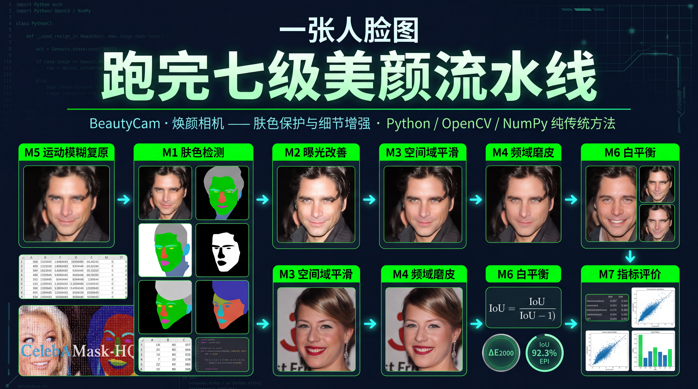
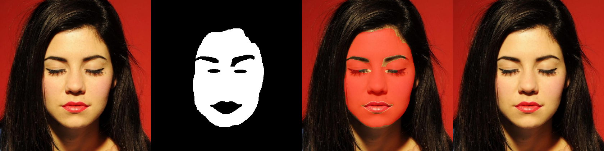
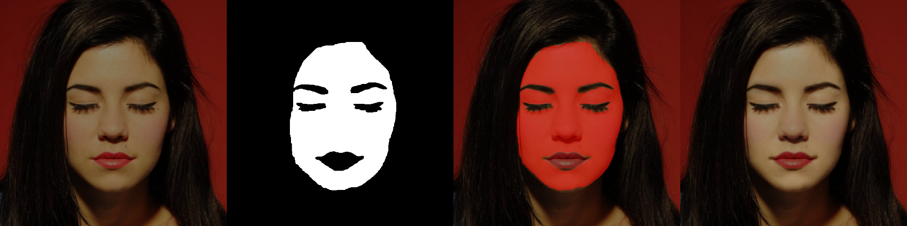
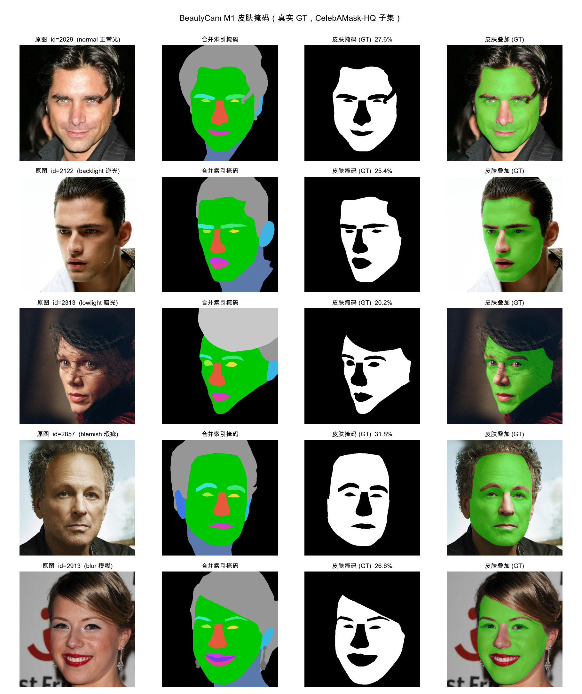

# 焕颜相机 BeautyCam —— 人脸美颜相机（数字图像处理课程设计）

<p align="center">
  
</p>

[](#)
[](#)
[](#)

> **本项目为《数字图像处理》课程设计（大作业）作品**：以传统图像处理方法实现一个人脸美颜相机，在不使用深度学习的前提下，完成肤色保护、曝光改善、保边磨皮与细节增强。

**📄 [点击查看课程知识点图文解答网页（GitHub Pages）](https://guts-yang.github.io/BeautyCam/)** —— 按课程知识点逐条给出概念、公式、源码实现位置与效果对照，是本作业的核心说明文档。

在线演示：[beauty-cam.streamlit.app](https://beauty-cam.streamlit.app)（Streamlit Community Cloud 自动部署；上传图片仅在进程内存中处理，不持久化保存）。

---

## 一、课程背景与设计目标

| 项目 | 内容 |
| --- | --- |
| 课程名称 | 《数字图像处理》 |
| 学院 | 计算机科学与工程学院 |
| 任课教师 | 沃焱 |
| 设计周期 | 2026 年 10 月 — 2026 年 12 月 |
| 选题 | 人脸美颜相机 —— 肤色保护与细节增强 |
| 技术路线 | Python + OpenCV + NumPy，全程传统方法，不训练深度学习模型 |

选题对应课程要求，围绕"如何在平滑皮肤的同时保护五官细节、避免肤色失真"这一核心问题，将课堂知识落到可运行的完整系统中。设计目标：

1. 用色彩空间转换与分割方法**准确圈定皮肤区域**，为后续处理提供作用域；
2. 通过直方图均衡、伽马校正等方法**改善曝光**并抑制过曝；
3. 用保边滤波与频域方法实现**磨皮与细节回注**的平衡；
4. 通过白平衡与饱和度调整保持**自然的肤色**；
5. 用客观指标与主观评价对效果进行**可量化的验证**。

## 二、功能与课程知识点对照

| 处理模块 | 采用的方法 | 对应课程知识点 | 网页章节 |
| --- | --- | --- | --- |
| M1 肤色检测 | YCrCb 阈值 + Haar 定位 + GrabCut 图割 + 五官保护 | 色彩空间、阈值分割、图割、连通域 | [第 1、4 章](https://guts-yang.github.io/BeautyCam/#fundamentals) |
| M2 曝光改善 | CLAHE + 自适应伽马 + 过曝保护 | 直方图均衡化、灰度变换 | [第 2 章](https://guts-yang.github.io/BeautyCam/#enhancement) |
| M3 保边平滑 | 双边滤波 + 中值暗点修补 + Otsu + 羽化 | 空间域滤波、双边滤波、阈值分割 | [第 3 章](https://guts-yang.github.io/BeautyCam/#filtering) |
| M4 频域增强 | 二维 FFT + 高斯高低频分离与回注 | 频域滤波、USM 锐化思想 | [第 7 章](https://guts-yang.github.io/BeautyCam/#sharpening) |
| M5 运动模糊复原 | 线性运动 PSF + 维纳反卷积（默认关闭） | 图像退化与复原 | [第 9 章](https://guts-yang.github.io/BeautyCam/#restoration) |
| M6 色彩调整 | Shades of Gray 白平衡 + HSV 饱和度 | 色度学、白平衡、色彩空间 | [第 8 章](https://guts-yang.github.io/BeautyCam/#color) |
| M7 质量评价 | IoU / Recall / PSNR / SSIM / ΔE2000 / EPI | 图像质量评价 | [第 10 章](https://guts-yang.github.io/BeautyCam/#evaluation) |

主流程执行顺序为 **M5 → M1 → M2 → M3 → M4 → M6**，评价由 M7 完成；其中 M5 默认关闭，各阶段开关由 `config/pipeline.yaml` 管理。

## 三、核心算法原理简述

**肤色检测（M1）**：在 YCrCb 空间用色度阈值 `133 ≤ Cr ≤ 173, 77 ≤ Cb ≤ 127` 生成肤色候选，再用 Haar 级联定位人脸框，在框内用 GrabCut（GMM 建模）分割前景，并排除眉、眼、唇区域。分割结果经形态学与小连通域过滤得到皮肤掩码。

**曝光改善（M2）**：先在皮肤区域估计缓变亮度基底，执行 CLAHE 增强后，用自适应伽马曲线把平均亮度推向目标：

```
Y_out = 255 · (Y_in / 255)^exponent
desired = min(mean + gain·(target_y − mean), mean·max_gain)
```

处理后在实际输出上检查过曝比例，超标则二分减弱提升强度。

**保边平滑（M3）**：双边滤波同时考虑空间距离与颜色相似度，平滑皮肤而保留五官边缘：

```
w(p,q) = exp(−‖p−q‖²/2σ_s²) · exp(−‖I(p)−I(q)‖²/2σ_c²)
```

并用 Otsu 阈值与连通域分析只修补小型暗点，融合权重随掩码内距离衰减。

**频域增强（M4）**：用二维 FFT 与高斯低通函数分离亮度的高低频，再按增益回注细节：

```
H(fx,fy) = exp(−2π²σ²(fx²+fy²))
low = irfft2(rfft2(Y)·H),  high = Y − low
Y_out = lowpass_gain·low + highpass_gain·high
```

> 更多知识点、公式与源码对应位置，请见 [课程知识点解答网页](https://guts-yang.github.io/BeautyCam/)。

## 四、效果展示

下图为真实人脸的处理流程对照（原图 → 皮肤掩码 → 蒙版预览 → 最终输出）与欠曝样本的提亮效果：

<p align="center">
  
</p>
<p align="center">
  
</p>

不同场景下的皮肤区域标注与五官保护示意：

<p align="center">
  
</p>

上述指标由固定样本集的离线评测脚本复现（详见网页"图像质量评价"章节）。

## 五、运行方式（面向零基础评审）

使用 **Python 3.10 或 3.12**，依赖版本见 `requirements.txt`。在仓库根目录执行。

**macOS / Linux**

```bash
python3 -m venv .venv
source .venv/bin/activate
python -m pip install -r requirements.txt
python src/main.py --input assets/test-images/lena512.BMP --mode process
python -m streamlit run src/app.py
```

**Windows PowerShell**

```powershell
py -3.12 -m venv .venv
.\.venv\Scripts\python.exe -m pip install -r requirements.txt
$outputRoot = Join-Path $env:TEMP "BeautyCamOutput"
.\.venv\Scripts\python.exe src/main.py --input assets/test-images/lena512.BMP --mode process --output-root $outputRoot
.\.venv\Scripts\python.exe -m streamlit run src/app.py
```

说明：

- CLI 支持 `process`（处理）与 `evaluation`（评价）两种模式，结果写入 `data/output/<run_id>/`；
- UI 为 Streamlit 交互演示，启动后在浏览器打开提示的地址即可上传图片体验；
- Windows 下建议用 `--output-root` 指定仅含 ASCII 字符的可写目录；
- 运行评测需自备 CelebAMask-HQ 子集（教学/非商业用途），仅用于评分，不参与实际美颜处理。

## 六、目录结构

```
BeautyCam/
├── docs/
│   ├── index.html                 # 课程知识点解答网页（GitHub Pages 入口）
│   ├── assets/                    # 网页所用的效果图
│   └── baseline/                  # 需求分析、设计与架构说明文档
├── src/
│   ├── main.py                    # 命令行入口（单图 / 批处理 / 评价）
│   ├── app.py                     # Streamlit 演示入口
│   ├── prepare_data.py            # 数据集按需抽取与预处理
│   └── beauty/
│       ├── core/                  # 流水线编排与配置加载
│       ├── io/                    # 图像读写
│       ├── modules/               # M1–M6 算法模块
│       └── metrics/               # M7 指标计算
├── config/                        # 流水线与各模块参数（YAML）
├── assets/                        # 封面图、标准测试图集与评测清单
├── tools/                         # 离线评测与可视化脚本
├── tests/                         # 单元与集成测试
├── report/                        # 实现说明与图表素材
├── requirements.txt               # 依赖清单
└── README.md                      # 本文档
```

## 七、作业提交信息

| 项目 | 填写处 |
| --- | --- |
| 课程名称 | 《数字图像处理》 |
| 姓名 | `<请填写>` |
| 学号 | `<请填写>` |
| 提交日期 | `<请填写>` |

提交材料建议包含：课程设计报告、本网页文档（GitHub Pages 链接或 `docs/index.html`）、程序源码。仅提交源码，不包含可执行文件。

---

*本项目为课程设计教学用途，所有算法描述与结果均可追溯至仓库源码与评测脚本；详情请见[课程知识点解答网页](https://guts-yang.github.io/BeautyCam/)。*
