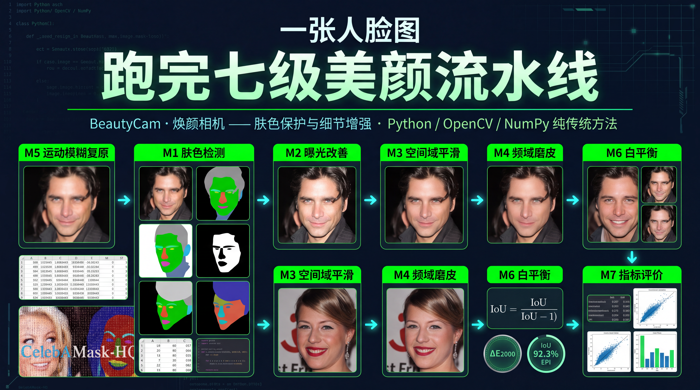

# 焕颜相机 BeautyCam —— 人脸美颜相机（数字图像处理课程设计，2026）

<p align="center">
  
</p>

《数字图像处理》课程设计（大作业）项目代码、数据与文档仓库。

- 学院：计算机科学与工程学院
- 任课教师：沃焱
- 周期：2026 年 10 月 — 2026 年 12 月
- 选题：人脸美颜相机——肤色保护与细节增强
- 技术栈：Python + OpenCV + NumPy（全程传统方法，不使用深度学习）

## 项目约束基线（新成员请先读）

本项目采用规范驱动开发（SDD），开发前必须先理解以下三份基线文档（位于 `docs/baseline/`）。它们定义了"什么事能做、怎么做"，任何实现都不得违反：

| 文档 | 回答的问题 | 关键内容 |
| --- | --- | --- |
| [prd.md](docs/baseline/prd.md) | 系统要做什么 | 需求编号规则、优先级、验收标准格式、需求清单与范围边界 |
| [design.md](docs/baseline/design.md) | 该怎么做、什么禁止做 | UI/UX 设计系统（色彩 Token、字阶、交互状态）与算法代码红线 |
| [arch.md](docs/baseline/arch.md) | 用什么搭、如何组织 | 技术栈、目录结构、模块职责与接口、数据契约、测试与运行 |

阅读顺序建议：`prd.md` → `arch.md` → `design.md`。三者关系是"需求定义做什么、架构定义怎么搭、设计定义怎么做且什么禁止做"。

三份文档均已锁定为 v1.0 基线（已确认）。数值阈值按文档内预设值执行，开发中经实测确需调整时走 `change-request` 变更流程，不得单方面放宽。

数据获取顶层约束（不可违反）：所有数据集相关脚本（下载、解压、预处理、抽样）一律只获取工作所需的最小样本子集，禁止下载完整数据集或做全量抽取。本课题不训练深度模型，只需 20~50 张，因此任何数据脚本都不得拉取整包或遍历全量。CelebAMask-HQ 官方 zip 为 3.15GB、解压后约 30GB，`src/prepare_data.py fetch` 以 HTTP Range 按需抽取（实测 40 张约 66MB）；新增数据脚本须遵循同一约束。个别样本缺标注只会跳过，不得因此改为全量拉取。确需全量数据时须走 `change-request` 评审。

模块归属口径（三板块，与 `docs/issue规划.md` 一致）：A（GitHub `guts-yang`）负责流程编排与入口（`core/`、`io/`、CLI、UI）；B（GitHub `qixing1227`）负责 M1–M4（`skin_detect`、`exposure`、`smooth`、`freq_enhance`）；C（GitHub `Shiqi0502`）负责 M5–M7（`restore`、`color`、`metrics`）。

## 目录结构

```
BeautyCam/
├── docs/                       # 文档
│   ├── baseline/               # ★ 项目约束基线（新成员先读这里）
│   │   ├── prd.md              # 需求模板基线（需求怎么写、验收标准格式）
│   │   ├── design.md           # 设计约束基线（UI/UX 与算法代码红线）
│   │   └── arch.md             # 架构约束基线（技术栈、结构、接口、测试）
│   ├── course-original-docs/    # 压缩包导出的课程文档：任务书/评分标准、实验报告、考核安排、课程设计报告
│   ├── 选题审核报告-人脸美颜.md  # 选题讨论报告（组内传阅）
│   ├── 设计方案-人脸美颜.md      # 设计方案（模块划分、分工、结果产出）
│   ├── 架构设计与任务分工规划.md  # 架构设计与任务拆分（工作分解，三板块版）
│   ├── issue规划.md             # GitHub Issue 规划（8 Epic / 27 Issue，三板块解耦分工）
│   └── 社群分享文案.md           # 组内分派用的社群文案（板块认领 + 提交规范）
├── assets/
│   ├── canvas.png             # 项目总览封面图（README 顶部引用）
│   ├── test-images/            # 课程统一提供的标准测试图集（50 张）
│   └── evaluation_manifest.csv # 固定评测样本清单（sample_id,scene）
├── src/                        # 源码
│   ├── main.py                 # CLI 薄入口（单图 / 批处理）
│   ├── app.py                  # Streamlit 薄入口（本地演示）
│   ├── prepare_data.py         # CelebAMask-HQ 数据预处理
│   └── beauty/                 # 主包（分层：core / io / modules / metrics）
│       ├── core/               # 编排、配置与入口契约（A）
│       ├── io/                 # 图像读写与产物落盘（A）
│       ├── modules/            # M1–M6 算法模块（M1–M4 归 B，M5/M6 归 C）
│       └── metrics/            # M7 评价与指标（C）
├── tests/
│   ├── unit/                   # 单元测试与契约守卫（合成数据）
│   └── integration/            # 集成与回归测试
├── config/                     # pipeline.yaml + 各模块独立 YAML
├── .github/workflows/          # CI：单元/契约/集成三 job 回归流水线
├── .streamlit/config.toml      # Streamlit 主题映射
├── data/
│   ├── input/                  # 输入素材（CelebAMask-HQ 子集等）
│   └── output/                 # 处理结果图
├── results/                    # 评测数据（指标 CSV）与结论
├── report/                     # 课程设计报告
├── slides/                     # 答辩 PPT
├── .gitignore
└── README.md
```

## 关键时间节点

| 事项 | 时间 | 需准备材料 |
| --- | --- | --- |
| 填写分组与选题表 | 第 12 周前 | 腾讯文档在线填表 |
| 实验检查 | 第 16 周（暂定） | 实验报告（打印版）、程序源码、笔记本电脑 |
| 答辩展示 | 第 17 周（暂定） | 课程设计报告、答辩 PPT、源码、电脑 |

## 成绩构成

- 实验：20%
- 雨课堂学习与作业：20%
- 课堂考勤：10%
- 终结性课程论文（大作业）：50%

大作业评分细项：正确性 20%、设计合理性 20%、程序功能 20%、运行及答辩 20%、报告完成 20%。

## 提交命名规范

- 个人课程设计报告：`学号+姓名+大作业报告书`
- 个人实验报告：`学号+姓名+实验报告`
- 组内合并压缩包：`组别号+全部组员姓名`，如 `10张三+李四+王五`
- 只提交源码，不包含可执行文件

## 技术路线

选题对应课程要求「人脸美颜相机——肤色保护与细节增强」，处理流程划分为七个模块（详见 `docs/设计方案-人脸美颜.md`）：

1. 色彩空间转换与肤色检测
2. 曝光改善（CLAHE + 自适应伽马校正）
3. 空间域皮肤平滑与边缘保护
4. 频率域磨皮与细节增强
5. 轻微运动模糊复原
6. 彩色增强与白平衡
7. 评价与输出

## 数据集

### 候选方案评估

选题确定后，对公开可获取的人脸数据集做了横向筛选，评估维度为「规模与分辨率」「是否自带标注」「素材获取难度」「与本选题的契合度」：

| 数据集 | 规模 / 分辨率 | 配套标注 | 对本选题的契合度 |
| --- | --- | --- | --- |
| FFHQ | 70,000 张 / 1024x1024 | 无 | 高清、肤色年龄背景多样，但无标注，肤色区域全靠自检 |
| CelebA | 202,599 张 / 178x218 | 40 项属性 | 属性标注全，但分辨率偏低，不利于观察皮肤细节 |
| CelebAMask-HQ | 30,000 张 / 1024x1024 | 19 类语义掩码 | 最高，自带皮肤/五官/头发分割掩码 |
| Helen | 2,330 张 / 400x400 | 68 关键点 | 体积小、关键点便于定位五官，但无皮肤掩码 |
| 300W / WFLW | 3,837 / 10,000 张 | 68 关键点 | 适合五官定位，分辨率与场景受限 |
| SCUT-FBP5500 | 5,500 张 / 350x350 | 颜值评分 | 偏颜值评估，与增强处理关系弱 |
| LFW | 13,233 张 / 250x250 | 身份标签 | 偏人脸识别用途，分辨率低 |
| 课程自带图集 | 约 10 张人脸图 | 无 | 零成本，可作为基础演示补充 |

筛选结论：本选题核心环节之一是「肤色区域检测与保护」，需要一份可作为标准答案的皮肤区域标注，因此淘汰无标注的 FFHQ、CelebA 与用途不符的 LFW、SCUT-FBP5500；Helen、300W/WFLW 虽有关键点但缺皮肤掩码，仅作备选。

### 最终选定

主数据集为 CelebAMask-HQ，理由：

- 自带 19 类语义掩码，其中索引 1 即皮肤区域，可直接作为肤色检测的标准答案（GT），用于限定磨皮作用域并量化肤色检测准确率；
- 1024x1024 高分辨率，便于观察磨皮与细节增强效果；
- 覆盖多年龄、多肤色、多光照与遮挡场景，便于鲁棒性验证。

授权仅限非商业研究/教学用途，不纳入版本管理（见 `.gitignore`），获取方式与标签说明见 `data/input/README.md`。

### 数据子集筛选

课设不训练深度模型，无需全量数据，因此对数据集做了二次筛选：从 30,000 张中抽取 20~50 张工作子集，按场景分层覆盖，保证每类退化都有对应样本。

| 筛选维度 | 对应验证目标 |
| --- | --- |
| 正常光线、正面人脸 | 磨皮与五官锐化的基础效果 |
| 带痘印 / 噪点 / 油光 | 痘印抑制与肤质平滑 |
| 偏色 / 低曝光 | 白平衡与伽马校正 |
| 含眼镜 / 刘海遮挡 | 肤色检测的鲁棒性 |
| 轻微运动模糊 | 复原模块 |

执行方式有两种，推荐第一种：**从公开镜像按需抽取，不下载 3.15GB 整包**。脚本先读 zip 中央目录（约 50MB，40 万个条目的索引不可避免），再对需要的样本发起 HTTP Range 请求只取那几个字节。实测抽取 40 张共拉取约 66MB，相比整包节省约 98%。

```bash
# 推荐：远程按需抽取（不需要先下载整包）
python src/prepare_data.py fetch --out data/input/subset --num 40 \
    --manifest assets/evaluation_manifest.csv
```

如果已自行具备完整数据集（授权仅限非商业研究，须自行获取），则走本地路径 `subset`：它先按固定种子抽样，再只合并抽中样本的掩码，不对全量 30000 张做扫描或合并。`fetch` 与 `subset` 的抽样规则一致（排序 + 固定种子 42），同一数据集下产出的 `sample_id` 相同，可互相校验。

```bash
python src/prepare_data.py subset --root data/input/CelebAMask-HQ \
    --out data/input/subset --num 40 --manifest assets/evaluation_manifest.csv
```

若只想单独合并少量指定样本的掩码（例如排查某个样本），用 `merge` 并显式给出 ID，避免全量扫描：

```bash
python src/prepare_data.py merge --root data/input/CelebAMask-HQ --ids 10507,11300
```

输出结构为 `images/`（1024×1024 原图）、`masks/`（512×512 合并索引掩码，索引 1 为皮肤）、`skin_masks/`（皮肤二值掩码，uint8 0/255）。个别样本在官方数据集中缺皮肤标注，`fetch` 会自动跳过，保证 GT 完整。

生成的 `assets/evaluation_manifest.csv` 含 `sample_id,scene` 两列，不含机器绝对路径与图像像素。`scene` 为占位标签，五类场景（`normal/backlight/lowlight/blemish/blur`）须人工核验后确认，不得凭随机种子宣称已实现分层抽样。

## 快速开始

环境要求 Python 3.10.x。所有直接依赖已精确 pin 在 `requirements.txt`。

```bash
# 1. 创建虚拟环境并安装依赖
python3.10 -m venv .venv
source .venv/bin/activate
python -m pip install -r requirements.txt

# 2. 单图处理（结果写入 data/output/<run_id>/）
python src/main.py --input assets/test-images/lena512.BMP

# 3. 目录批处理（失败项写入 results/<run_id>/failures.csv 后继续）
python src/main.py --input data/input/subset/images

# 4. 本地 Streamlit 演示（仅供本地，不作为公网服务）
streamlit run src/app.py

# 5. 单元测试与契约守卫（不需要数据集）
python -m pytest -m "not integration and not end_to_end"

# 6. 端到端集成回归（合成数据 + 临时目录，不需要数据集，CI 常跑）
python -m pytest -m end_to_end

# 7. 数据集评测回归（需先准备本地数据集与固定 manifest）
export BEAUTYCAM_DATA_ROOT=data/input/subset
python -m pytest -m integration
```

配置位于 `config/`：`pipeline.yaml` 放固定顺序、阶段开关与运行模式；各模块参数放独立 YAML。参数覆盖优先级为代码默认值 < YAML < 本次 CLI/UI 显式覆盖。

## 测试与回归

测试分层与回归门禁见 [设计方案-人脸美颜.md](docs/设计方案-人脸美颜.md) 第 6 章：

- 单元测试与契约守卫（`pytest -m "not integration and not end_to_end"`）：每次 PR 必跑，只使用内存合成数据。
- 端到端回归（`pytest -m end_to_end`）：合成数据 + 临时目录跑真实 CLI 全链路，不需要数据集，随 PR 与 push 都执行，是集成 job 的实质内容。
- 数据集评测回归（`pytest -m integration`）：需本地数据集与固定 manifest；未配置 `BEAUTYCAM_DATA_ROOT` 时明确跳过，不伪装为通过。
- 回归基线分契约、数值、图像三类；失败不得用 `skip`/`xfail`/放宽阈值规避，基线变更走 `change-request`。

CI 见 `.github/workflows/tests.yml`，含 `unit-regression`、`contract-guard`、`integration-regression` 三个 job，统一在 Ubuntu + Python 3.10.x 执行。`main` 已开启分支保护：上述前两个 job 为必需状态检查，合并需经 PR，禁止直接 push 与强推。