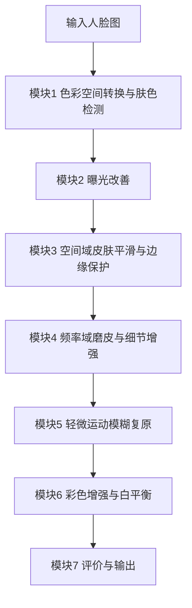

# 轻颜相机 —— 肤色保护型人脸美颜系统 设计方案

> 对应题目：4. 人脸美颜相机——肤色保护与细节增强
> 课程：《数字图像处理》课程设计（2026）
> 技术栈：Python + OpenCV + NumPy（全程传统方法，不使用深度学习）
> 团队：3 人

---

## 一、项目命名

| 项目 | 命名 |
| --- | --- |
| 中文系统名 | 轻颜相机 —— 肤色保护型人脸美颜系统 |
| 英文代号 | `BeautyCam-DIP`（DIP = Digital Image Processing） |
| 代码主包 | `beauty` |
| 仓库目录 | `course_project/`（沿用现有结构） |
| 答辩 PPT 名 | `学号+姓名+大作业报告书` / PPT 同名 |

命名约定：所有源码文件、函数、变量统一用 snake_case；模块文件按"处理阶段"命名，与下方技术路线一一对应，方便报告与代码对照。

---

## 二、数据集

**主数据集：CelebAMask-HQ**（已在 `data/input/README.md` 中给出获取方式）

- 来源：CelebA-HQ 精选的 30,000 张 1024x1024 高清人脸图，每张配 512x512、19 类语义掩码。
- 协议：仅限非商业研究/教学用途，不入库（`.gitignore` 已排除）。
- 使用规模：本课题不训练模型，仅抽取 20~50 张作为工作子集即可。

**关键用法**：合并掩码中像素值 `1` 即皮肤区域，作为"肤色检测"的标准答案（GT），用于两处：

1. 验证肤色检测模块的准确率（IoU / 准确率 / 召回率）；
2. 限定磨皮作用域，并在评价时单独统计肤色区的平滑度与色偏。

**子集筛选维度**（覆盖鲁棒性场景，各取若干张）：

| 场景 | 验证目标 |
| --- | --- |
| 正常正面光 | 基线磨皮 + 五官锐化 |
| 痘印/噪点/油光 | 痘印抑制能力 |
| 偏色/欠曝 | 白平衡与曝光校正 |
| 眼镜/刘海遮挡 | 肤色检测鲁棒性 |
| 轻微运动模糊 | 复原模块 |

辅助素材：可再自拍 5~10 张补充真实手机拍摄场景，增强答辩说服力。

---

## 三、技术路线（严格对齐题目 4 的七项要求）



模块与题目要求对应关系：

1. 色彩空间转换与肤色检测 → 模块 1
2. 空间域滤波平滑皮肤、保护边缘 → 模块 3
3. 频率域高斯低通/高通组合磨皮与细节增强 → 模块 4
4. 直方图均衡或伽马校正改善曝光 → 模块 2
5. 轻微运动模糊复原 → 模块 5
6. 彩色增强与白平衡，避免肤色偏色 → 模块 6
7. 主观评价为主，辅以边缘保持指标 → 模块 7

各模块技术要点：

- 模块 1：RGB→YCbCr/HSV/Lab 转换；用 YCbCr 的 Cb-Cr 椭圆模型与 HSV 的 H-S 范围取交集做肤色检测，形态学开闭 + 保留最大连通域；与 GT 掩码比对，输出 IoU。
- 模块 2：在亮度通道（Y 或 V）做 CLAHE + 自适应伽马校正（依亮度均值决定 gamma），避免整体过曝。
- 模块 3：双边滤波 / 导向滤波做保边平滑；痘印通过局部高对比 + 色度异常检测后局部修复；作用域由肤色掩码限定，五官区排除。
- 模块 4：FFT 后高斯低通得"平滑层"、高通得"细节层"（频率分离思路）；皮肤区以低频为主实现磨皮，五官区叠加高频实现锐化。
- 模块 5：对模糊图做退化建模，用倒谱/Hough 估计运动长度与角度，逆滤波或维纳滤波复原。
- 模块 6：灰度世界 / 完美反射白平衡；在 Lab 的 a/b 通道对肤色区做色度约束，避免偏色。
- 模块 7：主观问卷（1-5 分，20 人以上）+ 客观指标（边缘保持指数 EPI、磨皮前后 SSIM、肤色区局部方差下降率、肤色 ΔE2000）。

---

## 四、技术分工（3 人）

按"模块边界清晰、可并行开发、每人都有算法亮点"原则划分：

| 成员 | 负责模块 | 交付物 | 对应评分项 |
| --- | --- | --- | --- |
| 成员 A（检测与曝光） | 模块 1 + 模块 2 | `skin_detect.py`、`exposure.py`、肤色检测准确率表 | 设计合理性 |
| 成员 B（磨皮与细节） | 模块 3 + 模块 4 | `smooth.py`、`freq_enhance.py`、频域前后对比图 | 程序功能 |
| 成员 C（复原·色彩·评价） | 模块 5 + 模块 6 + 模块 7 | `restore.py`、`color.py`、`metrics.py`、指标 CSV | 正确性 + 报告 |

- 三人共担：`main.py` 主流程集成、`config.yaml` 参数统一、报告与 PPT 分工撰写。
- 集成约定：所有模块暴露统一接口 `process(img, mask, cfg) -> img`，主流程串联，确保"正确性"项可被逐模块测试。
- 里程碑评审：第 1 周定接口、第 3 周各模块单测通过、第 5 周全流程联调、第 6 周出报告与答辩。

---

## 五、结果产出

围绕评分标准 5 个维度组织产出：

| 评分项（占比） | 对应产出 | 具体形式 |
| --- | --- | --- |
| 正确性 20% | 可运行工程 | 命令行 + 批量处理，含参数校验与异常处理；提供单元测试脚本 |
| 设计合理性 20% | 模块化架构 | 7 模块解耦、掩码驱动、`config.yaml` 统一参数、接口一致 |
| 程序功能 20% | 交互式演示 | 参数可调（磨皮强度/曝光/色温），单图与批量两种模式，前后对比输出 |
| 运行及答辩 20% | 演示与 PPT | 现场滑块调参演示；PPT 结构：背景→路线→模块→结果→亮点 |
| 报告完成 20% | 课程设计报告 | 按模板撰写，含设计过程、算法、问题与解决、图文结果分析 |

具体文件清单：

```
course_project/
├── src/
│   ├── main.py            # 主流程入口
│   ├── config.yaml        # 全流程参数
│   ├── beauty/            # 各模块
│   │   ├── skin_detect.py
│   │   ├── exposure.py
│   │   ├── smooth.py
│   │   ├── freq_enhance.py
│   │   ├── restore.py
│   │   ├── color.py
│   │   └── metrics.py
│   └── prepare_data.py    # 数据预处理（已完成）
├── data/
│   ├── input/             # CelebAMask-HQ 子集
│   └── output/            # 处理结果图
├── results/               # 指标 CSV + 对比图 + 可视化
├── report/                # 课程设计报告
└── slides/                # 答辩 PPT
```

结果图规范：每模块"输入-输出-差异"三联图；全流程"原图 vs 美颜图"大图；指标以 CSV + 柱状图呈现。

---

## 六、风险与对策

- 客观指标偏弱（美颜主观性强）：以主观问卷为主，辅以 EPI、肤色 ΔE、局部方差三类客观指标，规避 PSNR/SSIM 在磨皮场景失效的问题。
- 肤色检测在遮挡/偏光下不稳：模块 1 预留 HSV+YCbCr 双空间投票，并用形态学后处理兜底。
- 频域磨皮易产生"蜡像感"：模块 4 通过高通细节回注与五官区保护控制强度，参数可调。