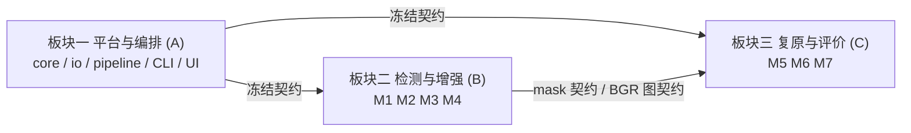
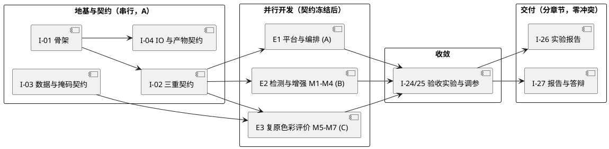

# 焕颜相机 BeautyCam —— GitHub Issue 规划（三板块版）

> 对应基线：[prd.md](./baseline/prd.md)、[arch.md](./baseline/arch.md)、[design.md](./baseline/design.md)
> 对应设计方案：[设计方案-人脸美颜.md](./设计方案-人脸美颜.md)
> 系统名：焕颜相机（BeautyCam）｜题目：4. 人脸美颜相机——肤色保护与细节增强
> 团队：3 人（A 为队长）｜技术栈：Python 3.10 + OpenCV + NumPy + Streamlit（纯传统方法）
> 版本：v2.0（三板块重排）｜上一版：v1.0（8 Epic / 24 Issue）

---

## 1. 本版修订说明

本版相对 v1.0 做三处实质调整，均以基线文档为准：

| 调整 | v1.0 | v2.0 | 原因 |
| --- | --- | --- | --- |
| 分工 | A 独占 M1/M2 + 集成 + PPT（11 个 Issue） | A 只做平台与编排；M1–M4 归 B；M5–M7 归 C | 消除负载失衡与单点瓶颈 |
| 接口契约 | 全模块统一 `process(img, mask, cfg)` | 按职责差异化签名（见 arch.md 5.1） | 对齐基线，M1/M5/M7 语义不同 |
| 配置契约 | 单一 `config.yaml` | `config/` 下每模块独立 YAML + `pipeline.yaml` | 对齐基线，支持模块 owner 独立改参 |

V1.0 的 A 同时是「地基提供者 + M1 掩码生产者 + 集成者 + 答辩负责人」，形成单点瓶颈；B 仅 4 个 Issue、C 仅 6 个，负载比约 11:4:6。v2.0 改为垂直切片，负载比约 8:7.5:6.5。

---

## 2. 规划目标与原则

Issue 规划的首要目标不是「把活儿列全」，而是让三人在契约冻结后零阻塞并行，把联调成本压到最低。据此确定四条原则：

1. **依赖倒置**：下游模块依赖契约，不依赖上游实现。M1 未完成时，B/C 用数据集自带 GT 掩码（经 `src/prepare_data.py` 生成的 `skin_masks/`）顶替，开发不等人。
2. **文件级私有**：一个目录/文件一个 owner，全仓无共享写入文件。
3. **契约即唯一串行点**：接口签名、模块配置 schema、掩码与产物落盘规范冻结一次后不得随意变更；确需变更须开 `change-request` Issue（见 prd.md 第 7 节）。
4. **集成显式立项**：联调不是「做完再说」，而是独立 Epic，占排期、有验收标准。

---

## 3. 三板块解耦设计

### 3.1 板块划分

系统按垂直切片分为三个自包含板块，每人独占一块。板块之间只通过 E0 冻结的契约通信。



| 板块 | 负责人 | 覆盖需求 | 独占目录与文件 |
| --- | --- | --- | --- |
| 一 平台与编排 | A | R8、R9、R10、R11、R12 | `src/beauty/core/`、`src/beauty/io/`、`src/main.py`、`src/app.py`、`src/prepare_data.py`、`config/pipeline.yaml`、`tests/integration/`、`.github/`、`requirements.txt`、`pytest.ini`、`.streamlit/config.toml`、`.gitignore` |
| 二 检测与增强 | B | R1、R1.1、R1.2、R2、R2.1、R2.2、R2.3、R3、R3.1、R3.2、R4 | `src/beauty/modules/{skin_detect,exposure,smooth,freq_enhance}.py`、`config/{skin_detect,exposure,smooth,freq_enhance}.yaml`、`tests/unit/test_{skin_detect,exposure,smooth,freq_enhance}.py` |
| 三 复原与评价 | C | R5、R6、R7、R7.1、R7.2、R13 | `src/beauty/modules/{restore,color}.py`、`src/beauty/metrics/metrics.py`、`config/{restore,color,metrics}.yaml`、`tests/unit/test_{restore,color,metrics}.py` |

### 3.2 关键解耦点

M1（肤色检测）在板块二，M6（色彩/白平衡）在板块三，M6 需要皮肤掩码才能做肤色区限定处理。这是全局唯一的跨板块数据依赖，靠两条措施解耦：

- M1 先于 M6 完成，其产出的掩码格式在 E0 已冻结为 `uint8 H×W`、取值 `0/255`；M6 只依赖这个格式，不 import `skin_detect.py`。
- M1 未完成期间，C 用数据集自带 GT 皮肤掩码（`skin_masks/`）开发 M6 与单测；架构上 `core.pipeline` 传入的 `skin_mask` 来源对 M6 不可见。

### 3.3 模块接口契约（冻结项，对齐 arch.md 5.1）

按职责差异化签名，不强制七模块返回同一对象：

```python
def detect_skin(image_bgr: np.ndarray, cfg: Mapping[str, Any]) -> np.ndarray:
    """M1：BGR uint8 HxWx3 -> 同尺寸 uint8 HxW 掩码，取值 0/255。"""

def process(image_bgr: np.ndarray, skin_mask: np.ndarray, cfg: Mapping[str, Any]) -> np.ndarray:
    """M2/M3/M4/M6：图像与掩码 -> 新的 BGR uint8 图像。"""

def get_frequency_diagnostics(image_bgr: np.ndarray, cfg: Mapping[str, Any]) -> Mapping[str, np.ndarray]:
    """M4 可选诊断：返回 low_frequency/high_frequency 两张同尺寸 BGR uint8 可视化图。"""

def restore_motion_blur(image_bgr: np.ndarray, cfg: Mapping[str, Any]) -> np.ndarray:
    """M5：BGR uint8 图像 -> 新的 BGR uint8 图像；不依赖 M1。"""

def compute_image_metrics(...) -> Mapping[str, Mapping[str, Any]]:
    """M7：对可用输入计算指标；返回纯数据记录，不做文件 I/O。"""

def summarize_survey(responses, cfg) -> Mapping[str, Any]:
    """M7：匿名问卷记录 -> 汇总统计；不读写文件。"""
```

### 3.4 三条协作红线

- `core/`、`io/`、`pipeline.yaml`、`requirements.txt`、CI 只有 A 能改；其他成员只提模块目录 PR。
- 任何模块不得直接 import 另一模块的私有函数；跨模块只走 `core.pipeline` 编排。
- 模块不得读写文件、不得维护全局状态；磁盘产物只由 `io/writer.py` 落盘，`metrics` 只做纯计算。

---

## 4. 数量与结构

- **Epic：8 个**｜**Issue：27 个**（含 4 个地基 Issue 与 3 个团队交付 Issue）
- 其中 4 个「地基」Issue（E0）必须先行完成以解锁并行；其余在契约冻结后分三线并行。
- 压缩方案：若嫌细碎，可将每模块的「实现 + 单测」合并，压到 8 Epic + 19 Issue；代价是失去「测试作为独立验收门槛」的机制，不推荐。

---

## 5. Epic 清单

| Epic | 名称 | 目标 | 负责人 | 覆盖需求 |
| --- | --- | --- | --- | --- |
| E0 | 平台地基与冻结契约 | 骨架 + 接口 + 配置 + 数据/掩码契约 + IO 与产物契约 | A | R8、R9 |
| E1 | 主流程与演示 | pipeline 编排 + CLI/批处理 + Streamlit + 集成测试与 CI | A | R8、R10、R11、R12 |
| E2 | 检测与增强链 | M1/M2/M3/M4 | B | R1–R4 |
| E3 | 复原·色彩·评价链 | M5/M6/M7 + 问卷汇总 | C | R5、R6、R7、R13 |
| E4 | 全流程验收实验 | 模块隔离评测 + 端到端实验 + 参数表 | A+B+C（分块） | 全部 P0 |
| E5 | 实验报告 | 实验 1–7 成文并打印 | A+B+C（分章节） | 交付物 |
| E6 | 课程设计报告 | 按模板成文 | A+B+C（分章节） | 交付物 |
| E7 | 答辩与演示 | PPT + 演示脚本 + 彩排 | A 统稿 | 交付物 |

---

## 6. Issue 清单

### 6.1 板块一 平台与编排（A）

| ID | 标题 | Epic | 标签 | 前置 | 验收标准 / 解耦点 |
| --- | --- | --- | --- | --- | --- |
| I-01 | 搭建 `src/beauty/` 包骨架与目录结构 | E0 | infra | - | 目录冻结对齐 arch.md 第 3 节；`python src/main.py --help` 可跑 |
| I-02 | 冻结三重契约：模块接口 + 配置 schema + 掩码格式 | E0 | contract | I-01 | 7 模块签名一致并可 import；桩函数满足 shape/dtype 契约；掩码定为 uint8 0/255；**全组第一优先，硬闸门** |
| I-03 | 数据子集与 GT 掩码产出（`prepare_data.py` + manifest） | E0 | contract,data | - | 生成 `images/`、`masks/`、`skin_masks/`；产出 `assets/evaluation_manifest.csv`（含 `sample_id,scene`，不含绝对路径与像素） |
| I-04 | IO 层与产物落盘契约 | E0 | contract,infra | I-01 | `io/reader.py`、`io/writer.py` 就位；产物路径、`metrics.csv`/`failures.csv` 字段顺序固定（对齐 arch.md 7.3） |
| I-05 | `core/pipeline.py` 流水线编排 | E1 | feature,pipeline | I-02,I-04 | 固定 M5→M1→M2→M3→M4→M6→M7 顺序；`pipeline.yaml` 阶段开关生效；M5 默认关闭 |
| I-06 | CLI 单图与批处理 + 异常隔离 | E1 | feature,infra | I-05 | GWT 通过；失败项写 `results/<run_id>/failures.csv`，后续样本继续 |
| I-07 | Streamlit 演示界面 | E1 | feature,ui | I-05 | GWT 通过；无 GT 时说明参考型指标不可评估；原图不自动持久化，须显式导出 |
| I-08 | 集成测试与 CI（主流程/空掩码/批处理隔离） | E1 | test,infra | I-05,I-06 | GitHub Actions 在 3.10.x 执行 `pytest -m "not integration"`；空掩码不崩、不误处理整图 |

### 6.2 板块二 检测与增强（B）

| ID | 标题 | Epic | 标签 | 前置 | 验收标准 / 解耦点 |
| --- | --- | --- | --- | --- | --- |
| I-09 | M1 肤色检测实现 | E2 | feature,M1 | I-02 | 输出同尺寸 0/255 掩码；掩码可视化正常；只吃 `image_bgr`，不读文件 |
| I-10 | M1 单测与 IoU/Recall 评估 | E2 | test,M1 | I-09 | IoU 宏平均 ≥ 0.75、Recall ≥ 0.80；空 GT 与遮挡样本不崩 |
| I-11 | M2 曝光改善实现 | E2 | feature,M2 | I-02 | 皮肤区平均 Y 相对提升 ≥ 15%；处理后 `Y>250` 比例 ≤ 1% |
| I-12 | M2 单测与直方图对比图 | E2 | test,M2 | I-11 | 输入不变性、dtype/shape 契约通过；前后直方图产出 |
| I-13 | M3 空间域平滑实现 | E2 | feature,M3 | I-02 | 只吃 mask、不 import M1；皮肤局部方差下降率 20%–40% |
| I-14 | M3 单测与三联图 | E2 | test,M3 | I-13 | 五官 GT 区 EPI ≥ 0.80；三联图可入报告 |
| I-15 | M4 频域增强实现 | E2 | feature,M4 | I-02 | 高频能量保留率 0.70–1.30；`get_frequency_diagnostics` 出分层图且不改主输出 |
| I-16 | M4 单测与频谱/分层图 | E2 | test,M4 | I-15 | 五官区 EPI ≥ 0.80；诊断图不修改输入 |

### 6.3 板块三 复原·色彩·评价（C）

| ID | 标题 | Epic | 标签 | 前置 | 验收标准 / 解耦点 |
| --- | --- | --- | --- | --- | --- |
| I-17 | M5 运动模糊复原实现 | E3 | feature,M5 | I-02 | 使用清晰参考合成的运动模糊输入；不依赖 M1 |
| I-18 | M5 单测与模糊-复原对比图 | E3 | test,M5 | I-17 | 配对增量 PSNR ≥ +0.5 dB 且 SSIM ≥ +0.02；记录 PSF/噪声/随机种子 |
| I-19 | M6 色彩增强与白平衡实现 | E3 | feature,M6 | I-02 | 偏色输入皮肤区 ΔE2000 宏平均 ≤ 5；只依赖 mask 格式契约，不 import M1 |
| I-20 | M6 单测与前后对比图 | E3 | test,M6 | I-19 | 记录 RGB 通道增益；输入不变性通过 |
| I-21 | M7 评价与指标计算实现 | E3 | feature,M7 | I-04 | 纯计算、不读写文件；返回映射含 `value/unit/valid/not_applicable_reason`；无效值不得填 0 或 NaN |
| I-22 | M7 单测与可视化图表 | E3 | test,M7 | I-21 | 指标记录字段与有效/无效值规则通过；图表可直接入报告 |
| I-23 | 匿名问卷汇总（R7.1） | E3 | feature,M7 | I-21 | 问卷 ≥ 20 份有效；输出 `results/survey/<survey_run_id>/summary.csv`，不含原始答卷与身份信息 |

### 6.4 团队交付（共担，文件边界隔离）

| ID | 标题 | Epic | 标签 | 前置 | 验收标准 / 解耦点 |
| --- | --- | --- | --- | --- | --- |
| I-24 | 全流程验收实验（模块隔离 + 端到端） | E4 | test,evaluation | I-08,I-10,I-12,I-14,I-16,I-18,I-20,I-22 | 按 `module_isolated` profile 逐模块出指标；M5 显式开启；端到端单独报告不替代阈值 |
| I-25 | 全流程调参与参数表 | E4 | feature,tuning | I-24 | 最优参数集落 `config/*.yaml`；前后对比大图产出 |
| I-26 | 个人实验报告（实验 1–7） | E5 | doc | 各模块 | 每人一份，按模板成文，打印版就绪 |
| I-27 | 个人课程设计报告 + 答辩 PPT 与彩排 | E6,E7 | doc,demo | I-25 | 报告含设计/方法/过程/结果/总结，图文完整；PPT 结构清晰，现场调参演示通过彩排 |

> 共担 Issue 在 GitHub 上按人拆子任务分派，但文件边界严格隔离：I-24 按板块分块执行，I-26/I-27 只体现在「报告分章节撰写」，不体现在「共同编辑同一代码文件」。

---

## 7. 依赖关系



要点：

- `I-02` 是唯一硬闸门：冻结后 A/B/C 三条线完全并行。
- `I-03` 是 C 的第二依赖（M5/M6 单测需要 GT 掩码），但不阻塞 B。
- `I-24` 是唯一汇合点，按板块分块执行。
- 三板块之间无隐藏 import 依赖，联调只发生在 `I-24`。

---

## 8. 分工与解耦保证

| 成员 | 独占 Issue | 独占文件/目录 | 对外契约 |
| --- | --- | --- | --- |
| A | I-01~I-08、I-24 的平台分块、I-27 | `src/beauty/core/`、`src/beauty/io/`、`src/main.py`、`src/app.py`、`config/pipeline.yaml`、CI | 提供三重契约与编排入口 |
| B | I-09~I-16、I-24 的增强分块 | `modules/{skin_detect,exposure,smooth,freq_enhance}.py` + 对应 YAML | 只消费 image/mask 契约，不产出跨模块状态 |
| C | I-17~I-23、I-24 的评价分块 | `modules/{restore,color}.py`、`metrics/metrics.py` + 对应 YAML | M7 只做纯计算，落盘交给 A 的 `io` |

负载估算（人日）：

| 成员 | Epic 内容 | 估算 |
| --- | --- | --- |
| A | 地基 4（约 3.0）+ E1 平台 4（约 3.5）+ 报告/答辩统筹（约 1.5） | 约 8.0 |
| B | 4 模块 ×（实现 + 单测）（约 6.0）+ 报告分章节（约 1.5） | 约 7.5 |
| C | 3 模块 ×（实现 + 单测）（约 4.5）+ 问卷与汇总（约 1.0）+ 报告分章节（约 1.0） | 约 6.5 |

三人负载比约 8:7.5:6.5，无单点瓶颈。B 虽模块数最多但模块间同构（都是图像变换 + 掩码），C 虽模块数少但 M7 与问卷汇总为非图像工作，实际体感接近。

---

## 9. GitHub 具体设置

### 9.1 组织方式

- 使用 Issues + Projects(v2) 看板。
- Epic 用父 Issue + sub-issue 承载（备选：`epic` 标签 + 任务清单）。
- 看板列：`Todo` → `In Progress` → `In Review` → `Done`；额外加 `Blocked`。

### 9.2 标签体系

| 维度 | 取值 | 说明 |
| --- | --- | --- |
| type | `contract` `feature` `test` `doc` `infra` `ui` `tuning` `evaluation` | 工作性质 |
| area | `M1`~`M7` `pipeline` `data` | 模块/领域归属 |
| owner | `owner:A` `owner:B` `owner:C` | 责任人 |
| size | `S`（<0.5 天）`M`（0.5~1 天）`L`（>1 天） | 工作量 |
| 状态 | `status:blocked` | 被前置阻塞 |
| Epic | `epic` | 父 Issue 标记 |
| 变更 | `change-request` | 基线变更（见 prd.md 第 7 节） |

### 9.3 Milestone

对齐课程硬节点：

- `W12-选题确认`（第 12 周前，分组与选题表）
- `W16-实验检查`（实验报告打印版 + 源码 + 笔记本，暂定第 16 周）
- `W17-答辩`（课程论文报告 + 源码 + 可执行程序 + PPT，暂定第 17 周）

### 9.4 分支与 PR 规则

- 一个 Issue 一个分支：`feat/I-xx-简述`。
- PR 描述用 `Closes #xx` 关联对应 Issue。
- PR 必须通过对应模块单测与 CI 才能合入；模块 PR 不得夹带 `core/`、`io/`、`pipeline.yaml` 改动。
- 禁止跨 Issue 打包提交。
- 依赖关系用 GitHub 的 `blocked by` 显式标注。

---

## 10. 落地顺序

1. 先建 8 个 Epic 父 Issue，打 `epic` 标签。
2. 再建 27 个 Issue，按第 6 节配置 label / 责任人 / milestone / blocked-by。
3. 建立 Projects(v2) 看板，把 Issue 拖入对应列。
4. 组内评审确认 `I-02` 契约内容后，立即开工 E0，冻结契约，解锁并行。