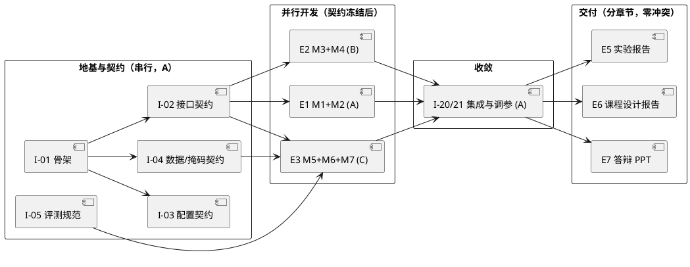

# 焕颜相机 BeautyCam —— GitHub Issue 规划

> 对应设计方案：[设计方案-人脸美颜.md](./设计方案-人脸美颜.md)
> 系统名：焕颜相机（BeautyCam）｜题目：4. 人脸美颜相机——肤色保护与细节增强
> 团队：3 人（A 为队长）｜技术栈：Python + OpenCV + NumPy（纯传统方法）

---

## 1. 规划目标与原则

Issue 规划的首要目标不是"把活儿列全"，而是**让三人在契约冻结后零阻塞并行**，把联调成本压到最低。据此确定四条原则：

1. **依赖倒置**：下游模块依赖的是"契约"，不是上游实现。M1 未完成时，B/C 用数据集自带的 GT 掩码顶替，开发不等人。
2. **文件级私有**：一个模块一个文件、一个 owner；全仓无共享写入文件。唯一共享的 `main.py`、`config.yaml` 归 A 独占。
3. **契约即唯一串行点**：接口签名、配置 schema、掩码格式、产物落盘规范冻结一次后禁止随意变更；确需变更须开新 Issue 并通知全组。
4. **集成显式立项**：联调不是"做完再说"，而是独立 Epic，占排期、有验收标准。

---

## 2. 解耦设计

### 2.1 四个抓手

| 抓手 | 做法 | 消除的耦合 |
| --- | --- | --- |
| 依赖倒置 | B/C 只消费 `mask` 契约，不 import M1 代码；无 M1 时用 GT 掩码 | B/C 不被 M1 进度阻塞 |
| 文件级私有 | 每模块单文件单 owner；`main.py`/`config.yaml` 仅 A 可改 | 消除写冲突 |
| 统一接口 | 跨模块只走 `process(img, mask, cfg) -> img` | 消除隐式调用与私有依赖 |
| 磁盘解耦 | M7 从 `data/output/` 读文件，不接收内存对象 | C 不被 A/B 的运行时状态阻塞 |

### 2.2 模块接口契约（冻结项）

```python
def process(img: np.ndarray, mask: np.ndarray | None, cfg: dict) -> np.ndarray:
    """
    img  : BGR uint8, HxWx3
    mask : uint8, HxW, 0/255 皮肤掩码；None 表示该模块不需要
    cfg  : dict，来自 config.yaml 的该模块参数子集
    返回 : BGR uint8, HxWx3
    """
```

### 2.3 三条协作红线

- `main.py`、`config.yaml` 只有 A 能改，其他成员只提模块 PR。
- 任何模块不得直接 import 另一模块的私有函数，跨模块只走统一接口。
- M7 评价统一从 `data/output/` 读产物，禁止把中间结果放进内存对象传递。

---

## 3. 数量与结构

- **Epic：8 个**｜**Issue：24 个**
- 其中 5 个为"地基"（E0 契约类），必须先行完成以解锁并行；其余 19 个在契约冻结后分三线并行，互不阻塞。
- 压缩方案：若嫌细碎，可将每模块的"实现 + 测试"合并，压到 8 Epic + 15 Issue；代价是失去"测试作为独立验收门槛"的机制，不推荐。

---

## 4. Epic 清单

| Epic | 名称 | 目标 | 负责人 |
| --- | --- | --- | --- |
| E0 | 地基与契约 | 骨架 + 接口 + 配置 + 数据/掩码契约 + 评测规范 | A |
| E1 | 肤色检测与曝光（M1+M2） | 需求 R1、R4 | A |
| E2 | 空间域与频域磨皮（M3+M4） | 需求 R2、R3 | B |
| E3 | 复原·色彩·评价（M5+M6+M7） | 需求 R5、R6、R7 | C |
| E4 | 集成与调参 | 七模块串联、参数寻优、批量产出 | A |
| E5 | 实验报告（个人） | 7 个实验成文并打印 | A+B+C |
| E6 | 课程设计报告（个人） | 按模板成文 | A+B+C |
| E7 | 答辩与演示 | PPT + 演示脚本 + 彩排 | A |

---

## 5. Issue 清单

| ID | 标题 | Epic | 标签 | 负责 | 前置 | 解耦点 / 验收标准 |
| --- | --- | --- | --- | --- | --- | --- |
| I-01 | 搭建 `src/beauty/` 骨架与包结构 | E0 | infra | A | - | 目录冻结，`python src/main.py --help` 可跑 |
| I-02 | 冻结模块接口契约 + 桩函数 | E0 | contract | A | I-01 | 7 模块签名一致，桩函数原样返回入参，单测可跑 |
| I-03 | `config.yaml` + 加载器 | E0 | contract | A | I-01 | 参数集中、schema 固定，各模块只读 |
| I-04 | 数据/掩码契约 + 子集与 GT 掩码 | E0 | contract,data | A | - | 掩码定为 uint8 0/255；40 张子集 + 皮肤 GT 可用 |
| I-05 | 评测基线脚本 + 产物落盘规范 | E0 | contract,infra | A | I-04 | `metrics.csv` 表头固定、产物命名规则固定 |
| I-06 | M1 肤色检测实现 | E1 | feature,M1 | A | I-02 | 输出 `skin_mask`，掩码可视化正常 |
| I-07 | M1 单测与 IoU 评估 | E1 | test,M1 | A | I-06 | IoU ≥ 0.75，遮挡样本不崩 |
| I-08 | M2 曝光改善实现 | E1 | feature,M2 | A | I-02 | 亮度提升 ≥ 15%，过曝比 ≤ 1% |
| I-09 | M2 单测与直方图对比图 | E1 | test,M2 | A | I-08 | 前后直方图产出，指标达标 |
| I-10 | M3 空间域平滑实现 | E2 | feature,M3 | B | I-02 | 只吃 mask，不依赖 M1 代码 |
| I-11 | M3 单测 + 三联图 | E2 | test,M3 | B | I-10 | 方差下降 20%~40%，EPI ≥ 0.8 |
| I-12 | M4 频域磨皮实现 | E2 | feature,M4 | B | I-02 | 频率分离出图，五官锐化无振铃 |
| I-13 | M4 单测 + 频谱/分层图 | E2 | test,M4 | B | I-12 | 指标达标，图可入报告 |
| I-14 | M5 运动模糊复原实现 | E3 | feature,M5 | C | I-02 | 合成模糊上复原后 PSNR/SSIM 提升 |
| I-15 | M5 单测 + 模糊-复原对比图 | E3 | test,M5 | C | I-14 | 指标达标 |
| I-16 | M6 白平衡与色彩增强实现 | E3 | feature,M6 | C | I-02 | 偏色样本肤色 ΔE2000 ≤ 5 |
| I-17 | M6 单测 + 前后对比图 | E3 | test,M6 | C | I-16 | 指标达标 |
| I-18 | M7 评价与输出实现 | E3 | feature,M7 | C | I-05 | 读磁盘产物而非内存对象，`metrics.csv` 产出 |
| I-19 | M7 单测 + 可视化图表 | E3 | test,M7 | C | I-18 | 图表可直接入报告 |
| I-20 | 主流程集成与串联 | E4 | feature,integration | A | I-09,I-11,I-13,I-15,I-17,I-19 | 单图/批量跑通，失败写 `results/failures.csv` |
| I-21 | 全流程调参与参数表 | E4 | feature,tuning | A+B+C | I-20 | 最优参数集 + 前后对比大图 |
| I-22 | 个人实验报告（7 个实验） | E5 | doc | A+B+C | 各模块 | 按模板成文，打印版就绪 |
| I-23 | 个人课程设计报告 | E6 | doc | A+B+C | I-21 | 含设计/方法/过程/结果/总结，图文完整 |
| I-24 | 答辩 PPT + 演示脚本 + 彩排 | E7 | doc,demo | A | I-21,I-23 | PPT 结构清晰；现场调参演示通过彩排 |

---

## 6. 依赖关系



要点：

- `I-02` 是唯一硬闸门：冻结后 A/B/C 三条线完全并行。
- `E4` 是唯一汇合点，且只由 A 执行，不会出现三人改同一份主流程。
- `I-02` 的 blocked-by 为空，意味着它是全组第一优先。

---

## 7. 分工与解耦保证

| 成员 | 独占 Issue | 独占文件 | 对外契约 |
| --- | --- | --- | --- |
| A | I-01~I-09、I-20、I-21、I-24 | `main.py`、`config.yaml`、`skin_detect.py`、`exposure.py` | 提供 mask 契约与主流程入口 |
| B | I-10~I-13 | `smooth.py`、`freq_enhance.py` | 只消费 mask 与 BGR 图，不产出跨模块状态 |
| C | I-14~I-19 | `restore.py`、`color.py`、`metrics.py` | M7 只读磁盘产物，与实现细节解耦 |

共担 Issue（I-21、I-22、I-23）在 GitHub 上按人拆子任务分派，但**文件边界仍按上表隔离**，共担只体现在"报告分章节撰写"，不体现在"共同编辑同一代码文件"。

---

## 8. GitHub 具体设置

### 8.1 组织方式

- 使用 Issues + Projects(v2) 看板。
- Epic 用父 Issue + sub-issue 承载（备选：`epic` 标签 + 任务清单）。
- 看板列：`Todo` → `In Progress` → `In Review` → `Done`；额外加 `Blocked`。

### 8.2 标签体系

| 维度 | 取值 | 说明 |
| --- | --- | --- |
| type | `contract` `feature` `test` `doc` `infra` | 工作性质 |
| area | `M1`~`M7` `pipeline` `data` | 模块/领域归属 |
| owner | `owner:A` `owner:B` `owner:C` | 责任人 |
| size | `S`（<0.5 天）`M`（0.5~1 天）`L`（>1 天） | 工作量 |
| 状态 | `status:blocked` | 被前置阻塞 |

### 8.3 Milestone

对齐课程硬节点，不按周堆砌：

- `W12-选题确认`（分组与选题表，第 12 周前）
- `W16-实验检查`（实验报告打印版 + 源码 + 笔记本，暂定第 16 周）
- `W17-答辩`（课程论文报告 + 源码 + 可执行程序 + PPT，暂定第 17 周）

### 8.4 分支与 PR 规则

- 一个 Issue 一个分支：`feat/I-xx-简述`。
- PR 描述用 `Closes #xx` 关联对应 Issue。
- PR 必须通过对应模块单测才能合入；模块 PR 不得夹带主流程改动。
- 禁止跨 Issue 打包提交。
- 依赖关系用 GitHub 的 `blocked by` 显式标注。

---

## 9. 落地顺序

1. 先建 8 个 Epic 父 Issue，打 `epic` 标签。
2. 再建 24 个 Issue，按下表配置 label / 责任人 / milestone / blocked-by。
3. 建立 Projects(v2) 看板，把 Issue 拖入对应列。
4. 组内评审确认 `I-02` 契约内容后，立即开工 `E0`，冻结契约，解锁并行。