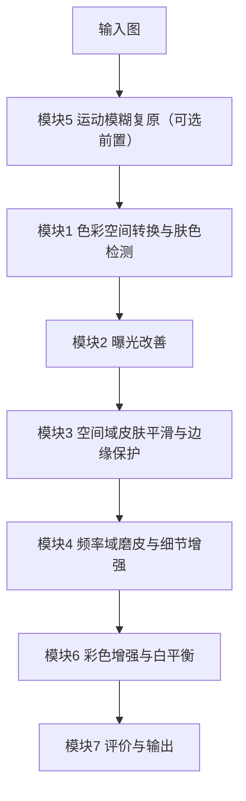

# 焕颜相机 —— 肤色保护与细节增强系统 详细设计方案

> 版本：v2.1（详细设计，供评审与 Issue 拆分）
> 对应题目：4. 人脸美颜相机——肤色保护与细节增强
> 课程：《数字图像处理》课程设计（2026）｜学院：计算机科学与工程学院｜任课教师：沃焱
> 技术栈：Python + OpenCV + NumPy（全程传统方法，禁用深度学习）
> 团队：3 人（A 为队长）

| 版本 | 状态 | 变更摘要 |
| --- | --- | --- |
| v1.0 | 已废弃 | 初版概要设计 |
| v2.0 | 待评审 | 展开为可落地详细设计；新增需求追溯、接口契约、参数表、验收标准、Issue 拆分方案 |
| v2.1 | 待评审 | 新增第 6 章「测试与回归策略」：测试分层、回归触发时机、黄金基线、回归门禁与 CI 回归流水线；同步协作规范、风险表与交付物清单 |

---

## 1. 项目概述

### 1.1 目标

实现一个「肤色保护型」人脸美颜相机系统：在保留皮肤纹理与五官边缘的前提下，完成去痘、磨皮、提亮、锐化、白平衡，并给出可量化的效果评价。系统须完整覆盖本学期四大技术板块——空间域增强、频率域增强、图像复原、彩色图像处理。

### 1.2 范围

- 输入：单张人脸图或人脸图批量目录（JPG/PNG/BMP）。
- 处理：7 个模块串行流水线，全部为传统图像处理算法。
- 输出：美颜结果图、各模块中间结果图、客观指标 CSV、可视化图表。
- 不做：人脸识别、属性分类、任何深度学习模型、移动端 App 封装。

### 1.3 硬约束

| 约束 | 说明 |
| --- | --- |
| 禁用深度学习 | 仅用传统方法；不得引入任何预训练模型 |
| 技术覆盖 | 必须含空间域、频率域、图像复原、彩色图像处理，缺一不可 |
| 三人分工 | 每人有独立分工，且每人须独立提交一份课程设计报告 |
| 只提交源码 | 提交物不含可执行文件 |
| 数据集不入库 | CelebAMask-HQ 仅限非商业研究/教学，`.gitignore` 已排除 |

### 1.4 命名与代号

| 项 | 命名 |
| --- | --- |
| 中文系统名 | 焕颜相机 —— 肤色保护与细节增强系统 |
| 英文代号 | `BeautyCam` |
| 代码主包 | `src/beauty/` |
| 报告命名 | `学号+姓名+大作业报告书`（个人）、`组别号+全部组员姓名`（组内压缩包） |
| 代码规范 | 文件/函数/变量统一 snake_case；模块文件按处理阶段命名，与需求编号一一对应 |

---

## 2. 需求追溯矩阵

题目 4 共 7 项要求，与模块、算法、验收指标一一对应，确保「不遗漏、可核查」。

| 需求编号 | 题目原文要求 | 对应模块 | 关键算法 | 验收指标 |
| --- | --- | --- | --- | --- |
| R1 | 色彩空间转换与肤色区域检测 | M1 肤色检测 | YCbCr 椭圆 + HSV 范围 + Lab 投票 | 肤色 IoU / 准确率 / 召回率 |
| R2 | 空间域滤波平滑皮肤、保护边缘 | M3 空间域平滑 | 双边滤波 / 导向滤波 + 掩码驱动 | 肤色区方差下降率、EPI |
| R3 | 频率域高斯低通/高通组合磨皮与细节增强 | M4 频域磨皮 | FFT + 高斯 LPF/HPF 频率分离 | 细节层能量保持率、五官 EPI |
| R4 | 直方图均衡或伽马校正改善曝光 | M2 曝光改善 | CLAHE + 自适应伽马 | 平均亮度提升、过曝像素比 |
| R5 | 轻微运动模糊复原 | M5 运动复原 | 退化建模 + 倒谱/Hough 估 PSF + 维纳滤波 | 复原前后 PSNR/SSIM 提升 |
| R6 | 彩色增强与白平衡，避免肤色偏色 | M6 色彩增强 | 灰度世界 / 完美反射 + Lab 色度约束 | 肤色 ΔE2000、色偏角 |
| R7 | 主观评价为主，辅以边缘保持指标 | M7 评价输出 | 主观问卷 + 客观指标集 | 主观均分、EPI/ΔE/SSIM 汇总 |
| 全局 | 正确性、设计合理性、程序功能 | 主流程 + 脚手架 | 差异化接口契约、配置化、异常处理 | 批量运行成功率 100% |

---

## 3. 系统架构

### 3.1 处理流水线



顺序说明：题目要求的编号顺序是「列举顺序」，不是执行顺序。本方案按图像处理逻辑排序——复原（M5）必须在增强之前，曝光（M2）必须在磨皮之前；M5 为条件模块，仅当输入存在运动模糊时启用，对清晰输入可配置跳过（`restore.enabled: false`）。每个模块均可在 `config.yaml` 中单独开关，便于答辩时逐模块演示。

### 3.2 模块接口契约

不强制七模块返回同一对象，按职责差异化定义签名。冻结内容以基线 `arch.md` 第 5.1 节为准，本节只作摘要：

```python
def detect_skin(image_bgr: np.ndarray, cfg: Mapping[str, Any]) -> np.ndarray:
    """M1：BGR uint8 HxWx3 -> 同尺寸 uint8 HxW 掩码，取值 0/255。"""

def process(image_bgr: np.ndarray, skin_mask: np.ndarray, cfg: Mapping[str, Any]) -> np.ndarray:
    """M2/M3/M4/M6：图像与掩码 -> 新的 BGR uint8 图像。"""

def get_frequency_diagnostics(image_bgr: np.ndarray, cfg: Mapping[str, Any]) -> Mapping[str, np.ndarray]:
    """M4 可选诊断：返回 low_frequency/high_frequency 两张同尺寸 BGR uint8 可视化图。"""

def restore_motion_blur(image_bgr: np.ndarray, cfg: Mapping[str, Any]) -> np.ndarray:
    """M5：BGR uint8 图像 -> 新的 BGR uint8 图像；不依赖 M1。"""

def compute_image_metrics(...) -> Mapping[str, Mapping[str, Any]]:
    """M7：对可用输入计算指标；返回纯数据记录，不做文件 I/O。"""

def summarize_survey(responses, cfg) -> Mapping[str, Any]:
    """M7：匿名问卷记录 -> 汇总统计；不读写文件。"""
```

约定：

- 所有图像输入输出均为 BGR uint8，色彩空间转换在模块内部完成，不跨模块传递。
- 掩码统一为同尺寸 uint8、取值 0/255；预测掩码与 GT 掩码严格区分，GT 只用于离线评测。
- 中间结果由主流程统一落盘到 `data/output/<run_id>/samples/<sample_id>/`；字段与路径契约见 arch.md 第 7.3 节。
- 主流程负责异常捕获：单图失败不中断批量，记录到 `results/<run_id>/failures.csv`。

### 3.3 配置设计（`config/` 下每模块独立 YAML）

单一 `config.yaml` 已废弃，改为按模块拆分配置，使各 owner 可独立改参且互不冲突；阶段开关与顺序集中在 `config/pipeline.yaml`。

```yaml
# config/pipeline.yaml（A）
pipeline:
  order: [restore, skin_detect, exposure, smooth, freq_enhance, color]
  restore_enabled: false        # M5 默认关闭，仅合成模糊评测时开启
  diagnostics: { frequency_enabled: false }
evaluation:
  profile: module_isolated      # 或 end_to_end
  target_module: null
io:
  input_dir: data/input/subset/images
  output_dir: data/output

# config/skin_detect.yaml（B）  method: vote, cb_range: [77,127], cr_range: [133,173],
#                               h_range: [0,50], s_min: 0.2, morph_kernel: 5, keep_largest: true
# config/exposure.yaml（B）     clip_limit: 2.0, tile_grid: 8, gamma_min: 0.8, gamma_max: 1.6
# config/smooth.yaml（B）       method: guided, radius: 8, eps: 1e-3, strength: 0.8,
#                               exclude_parts: [eye, eyebrow, mouth]
# config/freq_enhance.yaml（B） d0_low: 30, d0_high: 15, skin_low_ratio: 0.85, detail_gain: 1.3
# config/restore.yaml（C）      psf_method: cepstrum, noise_ratio: 0.01
# config/color.yaml（C）        wb_method: gray_world, chroma_clip: 0.06
# config/metrics.yaml（C）      评测协议，变更须 A/B/C 共同评审
```

### 3.4 目录结构

以基线 `arch.md` 第 3 节为准：

```
BeautyCam/
├── docs/                          # 选题报告、设计方案、基线文档 + course-original-docs/
├── assets/test-images/            # 课程标准测试图集（50 张）
├── src/
│   ├── main.py                    # CLI 薄入口，只调用 core
│   ├── app.py                     # Streamlit 薄入口，只调用 core
│   ├── prepare_data.py            # 数据预处理（已完成）
│   └── beauty/
│       ├── core/                  # config.py / contracts.py / pipeline.py（A 独占）
│       ├── io/                    # reader.py / writer.py（A 独占）
│       ├── modules/               # M1-M6（B/C 按模块独占）
│       └── metrics/               # metrics.py（M7，C 独占）
├── tests/{unit,integration}/      # 单元测试 / 集成测试
├── config/                        # pipeline.yaml + 每模块独立 YAML
├── data/{input,output}/           # 输入子集 / 运行产物
├── results/                       # 指标 CSV + 失败清单 + 图表
├── report/                        # 课程设计报告（个人）
└── slides/                        # 答辩 PPT
```

---

## 4. 模块详细设计

### M1 色彩空间转换与肤色检测（`skin_detect.py`，负责人 B）

| 项 | 内容 |
| --- | --- |
| 目标 | 稳定检测人脸皮肤区域，输出二值掩码，作为后续所有模块的作用域约束 |
| 输入 | BGR 图 |
| 输出 | `skin_mask`（uint8 0/255）+ 可选彩色掩码可视化 |
| 算法 | ① BGR→YCbCr，Cb-Cr 椭圆模型；② BGR→HSV，H-S 范围判定；③ 两者取交集/投票；④ 形态学开闭去噪；⑤ 保留最大连通域；⑥ 可选人脸区域先验裁剪 |
| 参数 | `cb_range/cr_range/h_range/s_min/morph_kernel/keep_largest` |
| 验收 | 子集上肤色 IoU ≥ 0.75；遮挡样本（眼镜/刘海）不出现大面积误检；输出与 GT 掩码叠加对比图 |
| 交付 | 掩码对比图、IoU 指标表、`skin_detect.py` |
| 风险 | 偏光/弱光下不稳定 → 双空间投票 + 形态学兜底 |

### M2 曝光改善（`exposure.py`，负责人 B）

| 项 | 内容 |
| --- | --- |
| 目标 | 提亮欠曝人脸，同时避免高光过曝、保持肤色自然 |
| 输入 | BGR 图 + 掩码 |
| 输出 | 曝光校正图 |
| 算法 | 转 YCbCr/HSV 取亮度通道；CLAHE 局部对比度增强；再依亮度均值做自适应伽马（暗图 gamma<1 提亮，亮图 gamma>1 压暗）；仅对肤色区加权，防止背景过曝 |
| 参数 | `clip_limit/tile_grid/gamma_min/gamma_max` |
| 验收 | 欠曝样本平均亮度提升 ≥ 15%；过曝像素比（>250）≤ 1%；前后对比图主观可辨 |
| 交付 | 曝光前后直方图对比图、`exposure.py` |

### M3 空间域皮肤平滑与边缘保护（`smooth.py`，负责人 B）

| 项 | 内容 |
| --- | --- |
| 目标 | 平滑皮肤痘印/噪点/油光，同时保住五官边缘与皮肤纹理 |
| 输入 | BGR 图 + 掩码 |
| 输出 | 平滑图 |
| 算法 | 双边滤波或导向滤波保边平滑；作用域由肤色掩码限定；五官（眼/眉/嘴）区域从掩码中剔除；痘印用「局部高对比 + 色度异常」检测后局部修复 |
| 参数 | `method/radius/eps/strength/exclude_parts` |
| 验收 | 肤色区局部方差下降率 20%~40%（过度即蜡像）；五官 EPI ≥ 0.8；无可见块状伪影 |
| 交付 | 平滑前后三联图、EPI 指标、`smooth.py` |

### M4 频率域磨皮与细节增强（`freq_enhance.py`，负责人 B）

| 项 | 内容 |
| --- | --- |
| 目标 | 用频率分离实现「皮肤磨皮 + 五官锐化」的分离处理，规避蜡像感 |
| 输入 | BGR 图 + 掩码 |
| 输出 | 频域增强图 |
| 算法 | FFT → 高斯低通得平滑层、高通得细节层；皮肤区以低频为主（磨皮），五官区叠加高频（锐化）；细节回注比例可调 |
| 参数 | `d0_low/d0_high/skin_low_ratio/detail_gain` |
| 验收 | 皮肤平滑但纹理仍在；五官锐度提升且无振铃；与 M3 结果对比说明频域优势 |
| 交付 | 频谱图、低/高频分层图、前后对比图、`freq_enhance.py` |
| 备注 | 本项目「反蜡像感」核心亮点，需重点出图与量化 |

### M5 轻微运动模糊复原（`restore.py`，负责人 C）

| 项 | 内容 |
| --- | --- |
| 目标 | 对轻微运动模糊输入做退化建模与复原 |
| 输入 | BGR 图 |
| 输出 | 复原图 |
| 算法 | 估计 PSF（倒谱法或 Hough 估运动长度/角度）；逆滤波或维纳滤波复原；加窗抑制振铃 |
| 参数 | `psf_method/noise_ratio` |
| 验收 | 人工合成运动模糊上，复原后 PSNR/SSIM 高于模糊图；真实样本主观可辨 |
| 交付 | 模糊-复原对比图、PSNR/SSIM 表、`restore.py` |

### M6 彩色增强与白平衡（`color.py`，负责人 C）

| 项 | 内容 |
| --- | --- |
| 目标 | 校正色偏、增强色彩，但严格避免肤色偏色 |
| 输入 | BGR 图 + 掩码 |
| 输出 | 色彩校正图 |
| 算法 | 灰度世界 / 完美反射白平衡；在 Lab 的 a/b 通道对肤色区做色度约束（限幅），防偏色 |
| 参数 | `wb_method/chroma_clip` |
| 验收 | 偏色样本肤色 ΔE2000 ≤ 5；白平衡前后对比可辨；肤色无偏红/偏黄 |
| 交付 | 前后对比图、ΔE 指标、`color.py` |

### M7 评价与输出（`metrics.py`，负责人 C）

| 项 | 内容 |
| --- | --- |
| 目标 | 主观评价为主、客观指标为辅，量化全流程效果 |
| 输入 | 原图 + 各阶段结果图 + 肤色掩码 |
| 输出 | `results/metrics.csv`、柱状图、主观问卷统计 |
| 主观 | 1-5 分问卷（磨皮自然度、提亮、肤色、细节、整体），≥20 人，覆盖肤色区与整体 |
| 客观 | 边缘保持指数 EPI、肤色区局部方差下降率、肤色 ΔE2000、磨皮前后 SSIM、复原 PSNR/SSIM |
| 参数 | `survey_csv/out_csv` |
| 验收 | 指标可复现、CSV 结构固定；图表可直接用于报告与答辩 |
| 交付 | `metrics.py`、指标 CSV、图表 |

---

## 5. 数据集与数据契约

| 项 | 内容 |
| --- | --- |
| 主数据集 | CelebAMask-HQ（30,000 张 1024×1024，19 类语义掩码） |
| 子集规模 | 抽取 40 张（覆盖 5 类场景，各 8 张） |
| GT 掩码 | 合并掩码中索引 `1` 即皮肤区域，作为 M1 的标准答案 |
| 子集场景 | 正常正面光 / 痘印噪点油光 / 偏色欠曝 / 眼镜刘海遮挡 / 轻微运动模糊 |
| 补充素材 | 自拍 5~10 张，增强真实性 |
| 数据契约 | `data/input/subset/images/*.png`、`data/input/subset/masks/*.png`（合并掩码）、`data/input/subset/skin/*.png`（皮肤 GT） |
| 预处理命令 | `python src/prepare_data.py merge --root ../data/input/CelebAMask-HQ`；`python src/prepare_data.py subset --root ../data/input/CelebAMask-HQ --out ../data/input/subset --num 40` |

---

## 6. 测试与回归策略

> 定位：测试是「地基」的组成部分，不是模块开发的附属品。任何一次合并到 `main` 都必须跑回归，确保新改动不破坏已冻结的契约与既有功能。本节与基线 `arch.md` 第 8 节互为补充——`arch.md` 规定测试框架与 CI 约束，本节规定回归的触发、基线与门禁。

### 6.1 测试分层

| 层 | 位置 | 数据来源 | 维护者 | 运行时机 |
| --- | --- | --- | --- | --- |
| 单元测试 | `tests/unit/` | 内存合成图/掩码/CSV fixture | 各模块 owner（B/C） | 本地 + 每个 PR |
| 契约守卫测试 | `tests/unit/test_contracts.py` | 纯合成数据 | A | 每个 PR；公共契约变更时必跑 |
| 集成测试 | `tests/integration/` | 固定 `assets/evaluation_manifest.csv` + 本地 GT | A | 合并 `main` 后 + 手动触发 |
| 回归测试 | 复用上述全集 + 基线比对 | 同上 | A 统筹 | 每次合并、里程碑前 |

单元测试只验证单个模块在合成数据上的行为契约，不依赖数据集；契约守卫测试把「冻结项」变成可执行的断言；集成测试验证主流程串起来仍能工作；回归测试则在每次合并时对以上全集加基线比对做整体兜底。

### 6.2 回归的触发时机

- **PR 阶段（快速回归）**：每个 PR 提交或更新时，CI 执行 `pytest -m "not integration"`，覆盖全部单元测试与契约守卫测试，必须全绿才允许评审。
- **合并到 main 后（全量回归）**：PR 合并触发 `main` 分支回归，在快速回归基础上追加集成测试（主流程单图、空掩码、批处理失败隔离），确认整条流水线未被破坏。
- **里程碑前（完整回归）**：实验检查、答辩前各跑一次完整回归，并刷新黄金基线快照。
- **可选：每日夜间回归**：以 `schedule` 触发，尽早发现长期漂移。

### 6.3 回归基线（黄金样本）

回归判定不只看「测试是否报错」，还要比对是否偏离已冻结的基线，分三类：

| 基线类型 | 内容 | 判定方式 | 更新方式 |
| --- | --- | --- | --- |
| 契约基线 | 7 个模块签名、掩码格式（uint8 0/255）、`metrics.csv`/`failures.csv` 字段顺序、config schema | 契约守卫测试断言 | 走 `change-request` |
| 数值基线 | 固定子集上的模块隔离指标阈值（IoU ≥ 0.75、Recall ≥ 0.80、EPI ≥ 0.80、ΔE2000 ≤ 5、PSNR +0.5 dB、SSIM +0.02 等） | 指标落在阈值区间内即通过 | 走 `change-request` |
| 图像基线 | 合成输入在固定参数下的确定性输出（哈希或 PSNR 容差） | 输出与基线在容差内一致 | 基线快照随算法确定性变更更新 |

约束：不得为让 CI 变绿而放宽阈值、跳过用例或删除测试；基线变更必须走 `change-request` 并由 A 合并。受限数据不入库，图像基线只保留合成 fixture 与指标记录。

### 6.4 回归门禁与失败处理

- 任一回归用例失败时，PR 不可合并；已合并的由 A 在 `main` 上定位到引入的模块与提交。
- 回归失败默认由引入改动的 owner 修复，A 负责判定是否需要回滚。
- 失败必须显式暴露，禁止用 `skip`/`xfail` 掩盖；`integration` 用例缺数据时明确「前置条件未满足」，不记为通过。

### 6.5 CI 中的回归流水线

`.github/workflows/tests.yml` 组织为多个 job：

| Job | 触发 | 内容 |
| --- | --- | --- |
| `unit-regression` | `pull_request` + `push main` | 安装 pin 依赖，跑 `pytest -m "not integration and not end_to_end"`，契约守卫用例（接口签名、掩码格式、CSV 字段顺序、配置 schema）随本 job 一并执行 |
| `integration-regression` | `pull_request` + `push main` + `workflow_dispatch` | 跑合成数据端到端用例 `pytest -m end_to_end`；需要本地数据集的 `integration` 用例仅在本地全量回归执行 |

CI 在 Ubuntu + Python 3.10.x/3.12.x 双版本矩阵运行；不下载受限数据、不访问需鉴权资源；依赖版本全部 pin，确保本地与 CI 结果一致。

### 6.6 与三板块解耦的配合

- 模块 PR 只改本模块与自有测试，回归范围限于本模块单测 + 契约守卫 + 快速回归，不阻塞并行。
- 公共契约、流水线、CI 的任何改动由 A 发起，合入前须通过完整回归并经至少一名其他成员评审。
- 回归是集成显式立项的一部分，服务于唯一汇合点 I-24（模块隔离评测 + 端到端验收），防止「各自通过、合起来崩」。

---

## 7. 评价体系

- 主观为主：问卷 1-5 分，≥20 人，重点问「是否自然」「有无蜡像感」「肤色是否偏色」。
- 客观为辅：EPI（边缘保持）、肤色 ΔE2000（色偏）、肤色区局部方差下降率（磨皮强度）、SSIM/PSNR（复原环节）。
- 刻意规避：磨皮场景下 PSNR/SSIM 会「越糊越高」，不作主指标，仅用于复原模块。
- 输出：`results/metrics.csv` + 每指标一张柱状图，直接对应报告「结果分析」章。

---

## 8. 进度与里程碑

课程硬节点（来自考核安排）：

| 节点 | 时间 | 需准备 | 依据 |
| --- | --- | --- | --- |
| 分组与选题表 | 第 12 周前 | 腾讯文档在线填表 | 考核安排 P8 |
| 实验检查 | 第 16 周（暂定） | 实验报告打印版 + 源码 + 笔记本 | 考核安排 P6 |
| 答辩展示 | 第 17 周（暂定） | 课程论文报告 + 源码 + 可执行程序 + 答辩 PPT | 考核安排 P7、P9 |

组内里程碑：

| 阶段 | 时间 | 任务 | 产出 | 负责人 |
| --- | --- | --- | --- | --- |
| 需求设计 | 第 1 周 | 选题确认、需求拆解、接口与参数定义、环境统一 | 本设计方案、接口契约 | A |
| 模块开发 | 第 2–4 周 | A/B/C 并行实现 7 模块 + 单元测试 | 各模块代码与对比图 | A + B + C |
| 集成联调 | 第 5 周 | `main.py` 串联、调参、指标产出 | 可运行工程 + metrics.csv | A 统筹 |
| 报告与 PPT | 第 5–6 周 | 图表整理、按模板写报告、做 PPT | 报告 + PPT | A + B + C |
| 实验与答辩 | 第 16–17 周 | 实验检查、试讲排练、现场答辩 | 演示脚本、问答预案 | A 统筹 |

实验报告（个人，7 个实验）：实验一~六为课程规定实验，实验七「人脸皮肤颜色分层」与本项目 M1 直接相关，可直接复用肤色检测成果。

---

## 9. 分工与协作规范

| 成员 | 负责板块 | 交付物 | 对应评分项 |
| --- | --- | --- | --- |
| A（队长，GitHub `guts-yang`） | 平台与编排：架构、接口契约、`core/`、`io/`、`pipeline.yaml`、CLI、Streamlit、CI，不实现算法模块 | `core/`、`io/`、`main.py`、`app.py`、配置与 CI | 设计合理性 |
| B（GitHub `qixing1227`） | 检测与增强：M1 + M2 + M3 + M4 | `skin_detect.py`、`exposure.py`、`smooth.py`、`freq_enhance.py`、频域分层图 | 程序功能 |
| C（GitHub `Shiqi0502`，已加入仓库并指派） | 复原与评价：M5 + M6 + M7 | `restore.py`、`color.py`、`metrics.py`、指标 CSV | 正确性 + 报告 |

协作规范：每人一条长期分支，分支名为本人名称简称（A `guts-yang` 为 `lcy`，B `qixing1227` 为 `lht`，C `Shiqi0502` 为 `lsq`）；开发在个人分支进行，完成后发 PR 到 `main`，由 A（GitHub `guts-yang`）统一评审合并；接口冻结后不得私自改签名；模块合并前须通过对应单元测试与 CI，**每次合并到 `main` 都必须跑回归（详见第 6 章）**，回归不通过不得合并；报告与 PPT 分工撰写、A 统稿。

---

## 10. 风险与对策

| 风险 | 影响 | 对策 |
| --- | --- | --- |
| 客观指标偏弱（美颜主观性强） | 结果分析无据 | 主观问卷为主 + EPI/ΔE/方差客观指标，规避 PSNR 陷阱 |
| 肤色检测在遮挡/偏光下不稳 | 后续模块作用域错误 | 双空间投票 + 形态学兜底 + 最大连通域 |
| 频域磨皮产生蜡像感 | 效果差、同质化 | 频率分离 + 细节回注 + 五官区保护，作为核心亮点 |
| 技术深度偏浅、易同质化 | 拿不到设计/功能高分 | 亮点落在肤色检测鲁棒性与频域「反蜡像感」并量化 |
| 三人并行接口不一致 | 集成失败 | 第 1 周冻结接口契约，先写桩函数与单测 |
| 合并引入回归破坏既有功能 | 后期联调频繁返工 | 每次合并强制执行回归测试；契约守卫测试 + 黄金基线比对；失败禁止合并 |
| 16/17 周时间紧、需印刷与排练 | 答辩失分 | 第 6 周前完成报告与 PPT 初稿，预留排练缓冲 |

---

## 11. 交付物清单

| 类别 | 交付物 | 对应评分项 |
| --- | --- | --- |
| 代码 | `src/` 全量源码（7 模块 + 主流程 + 预处理 + 单测） | 正确性、设计合理性 |
| 测试 | `tests/unit/`、`tests/integration/` 测试集 + CI 回归流水线 + 黄金基线快照 | 正确性、设计合理性 |
| 程序 | 命令行工具：单图 / 批量两种模式，参数可调 | 程序功能 |
| 数据 | `results/metrics.csv` + 各模块对比图 + 可视化图表 | 报告完成 |
| 文档 | 个人课程设计报告（`学号+姓名+大作业报告书`） | 报告完成 |
| 文档 | 个人实验报告（7 个实验） | 实验 20% |
| 演示 | 答辩 PPT + 现场调参演示脚本 | 运行及答辩 |
| 归档 | 组内压缩包 `组别号+全部组员姓名`（仅源码） | 提交规范 |

---

## 12. Issue 拆分方案

详见 [issue规划.md](./issue规划.md)（v2.0，三板块版）。本节不再重复明细，仅作摘要，避免两处口径漂移：

| 项 | 规格 |
| --- | --- |
| 结构 | 8 个 Epic + 27 个 Issue（E0–E7，I-01–I-27） |
| 板块一 平台与编排（A） | I-01 ~ I-08（骨架、三重契约、数据与掩码、IO 契约、pipeline、CLI、Streamlit、集成测试与 CI） |
| 板块二 检测与增强（B） | I-09 ~ I-16（M1/M2/M3/M4 各含实现与单测） |
| 板块三 复原与评价（C） | I-17 ~ I-23（M5/M6/M7 含单测与问卷汇总） |
| 团队交付（共担） | I-24 验收实验、I-25 调参、I-26 实验报告、I-27 报告与答辩 |
| 硬闸门 | I-02（三重契约冻结）冻结后三线并行 |
| 唯一汇合点 | I-24（模块隔离评测 + 端到端验收） |
| 标签体系 | `epic` `contract` `feature` `test` `doc` `infra` `ui` `tuning` `evaluation`、`M1`–`M7`、`owner:A/B/C`、`size:S/M/L`、`change-request` |

仓库已按该规划实际创建 8 个 Epic（#1–#8）与 27 个 Issue（#9–#35），并挂载 `blocked_by` 依赖与 3 个 Milestone（W12/W16/W17）。

---

## 13. 评审checklist

- [ ] 7 项要求是否全部有模块承载（见第 2 章）？
- [ ] 流水线顺序（M5 前置、M2 早于 M3/M4）是否认可？
- [ ] 按职责差异化接口（`detect_skin` / `process` / `restore_motion_blur` / `get_frequency_diagnostics` / `compute_image_metrics` / `summarize_survey`）是否作为冻结契约？
- [ ] A/B/C 三板块分工是否认可？
- [ ] 每模块独立 YAML 配置（取代单一 `config.yaml`）是否认可？
- [ ] 参数默认值是否合理，是否需要补充？
- [ ] 测试分层、回归触发时机与黄金基线是否认可（第 6 章）？
- [ ] 「每次合并必须跑回归、回归不通过不得合并」的门禁是否认可？
- [ ] Issue 拆分粒度是否合适，是否需要合并/拆分？