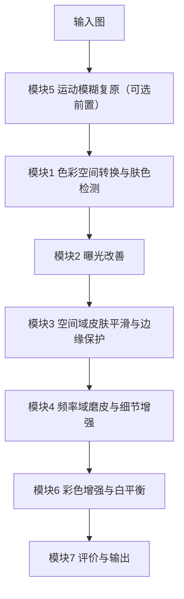

# 焕颜相机 —— 肤色保护与细节增强系统 详细设计方案

> 版本：v2.0（详细设计，供评审与 Issue 拆分）
> 对应题目：4. 人脸美颜相机——肤色保护与细节增强
> 课程：《数字图像处理》课程设计（2026）｜学院：计算机科学与工程学院｜任课教师：沃焱
> 技术栈：Python + OpenCV + NumPy（全程传统方法，禁用深度学习）
> 团队：3 人（A 为队长）

| 版本 | 状态 | 变更摘要 |
| --- | --- | --- |
| v1.0 | 已废弃 | 初版概要设计 |
| v2.0 | 待评审 | 展开为可落地详细设计；新增需求追溯、接口契约、参数表、验收标准、Issue 拆分方案 |

---

## 1. 项目概述

### 1.1 目标

实现一个「肤色保护型」人脸美颜相机系统：在保留皮肤纹理与五官边缘的前提下，完成去痘、磨皮、提亮、锐化、白平衡，并给出可量化的效果评价。系统须完整覆盖本学期四大技术板块——空间域增强、频率域增强、图像复原、彩色图像处理。

### 1.2 范围

- 输入：单张人脸图或人脸图批量目录（JPG/PNG/BMP）。
- 处理：7 个模块串行流水线，全部为传统图像处理算法。
- 输出：美颜结果图、各模块中间结果图、客观指标 CSV、可视化图表。
- 不做：人脸识别、属性分类、任何深度学习模型、移动端 App 封装。

### 1.3 硬约束

| 约束 | 说明 |
| --- | --- |
| 禁用深度学习 | 仅用传统方法；不得引入任何预训练模型 |
| 技术覆盖 | 必须含空间域、频率域、图像复原、彩色图像处理，缺一不可 |
| 三人分工 | 每人有独立分工，且每人须独立提交一份课程设计报告 |
| 只提交源码 | 提交物不含可执行文件 |
| 数据集不入库 | CelebAMask-HQ 仅限非商业研究/教学，`.gitignore` 已排除 |

### 1.4 命名与代号

| 项 | 命名 |
| --- | --- |
| 中文系统名 | 焕颜相机 —— 肤色保护与细节增强系统 |
| 英文代号 | `BeautyCam` |
| 代码主包 | `src/beauty/` |
| 报告命名 | `学号+姓名+大作业报告书`（个人）、`组别号+全部组员姓名`（组内压缩包） |
| 代码规范 | 文件/函数/变量统一 snake_case；模块文件按处理阶段命名，与需求编号一一对应 |

---

## 2. 需求追溯矩阵

题目 4 共 7 项要求，与模块、算法、验收指标一一对应，确保「不遗漏、可核查」。

| 需求编号 | 题目原文要求 | 对应模块 | 关键算法 | 验收指标 |
| --- | --- | --- | --- | --- |
| R1 | 色彩空间转换与肤色区域检测 | M1 肤色检测 | YCbCr 椭圆 + HSV 范围 + Lab 投票 | 肤色 IoU / 准确率 / 召回率 |
| R2 | 空间域滤波平滑皮肤、保护边缘 | M3 空间域平滑 | 双边滤波 / 导向滤波 + 掩码驱动 | 肤色区方差下降率、EPI |
| R3 | 频率域高斯低通/高通组合磨皮与细节增强 | M4 频域磨皮 | FFT + 高斯 LPF/HPF 频率分离 | 细节层能量保持率、五官 EPI |
| R4 | 直方图均衡或伽马校正改善曝光 | M2 曝光改善 | CLAHE + 自适应伽马 | 平均亮度提升、过曝像素比 |
| R5 | 轻微运动模糊复原 | M5 运动复原 | 退化建模 + 倒谱/Hough 估 PSF + 维纳滤波 | 复原前后 PSNR/SSIM 提升 |
| R6 | 彩色增强与白平衡，避免肤色偏色 | M6 色彩增强 | 灰度世界 / 完美反射 + Lab 色度约束 | 肤色 ΔE2000、色偏角 |
| R7 | 主观评价为主，辅以边缘保持指标 | M7 评价输出 | 主观问卷 + 客观指标集 | 主观均分、EPI/ΔE/SSIM 汇总 |
| 全局 | 正确性、设计合理性、程序功能 | 主流程 + 脚手架 | 统一接口、配置化、异常处理 | 批量运行成功率 100% |

---

## 3. 系统架构

### 3.1 处理流水线



顺序说明：题目要求的编号顺序是「列举顺序」，不是执行顺序。本方案按图像处理逻辑排序——复原（M5）必须在增强之前，曝光（M2）必须在磨皮之前；M5 为条件模块，仅当输入存在运动模糊时启用，对清晰输入可配置跳过（`restore.enabled: false`）。每个模块均可在 `config.yaml` 中单独开关，便于答辩时逐模块演示。

### 3.2 模块接口契约

所有处理模块必须实现统一签名，保证主流程可串联、可单独测试：

```python
def process(img: np.ndarray, mask: np.ndarray | None, cfg: dict) -> np.ndarray:
    """
    img  : BGR uint8, HxWx3，输入图（前一模块输出）
    mask : uint8, HxW，0/255，肤色掩码；None 表示该模块不需要掩码
    cfg  : dict，该模块的参数子集（来自 config.yaml）
    返回 : BGR uint8, HxWx3
    """
```

约定：

- 所有模块输入输出均为 BGR uint8，色彩空间转换在模块内部完成，不跨模块传递。
- 中间结果由主流程统一落盘到 `data/output/<stage>/`，命名 `<原图名>_<模块名>.png`。
- 主流程负责异常捕获：单图失败不中断批量，记录到 `results/failures.csv`。

### 3.3 配置设计（`src/config.yaml`）

```yaml
io:
  input_dir:  data/input/subset/images
  output_dir: data/output
  exts: [".jpg", ".png", ".bmp"]

pipeline:
  order: [restore, skin_detect, exposure, smooth, freq_enhance, color]

skin_detect:   { enabled: true,  method: vote, cb_range: [77, 127], cr_range: [133, 173],
                 h_range: [0, 50], s_min: 0.2, morph_kernel: 5, keep_largest: true }
exposure:      { enabled: true,  clip_limit: 2.0, tile_grid: 8, gamma_min: 0.8, gamma_max: 1.6 }
smooth:        { enabled: true,  method: guided, radius: 8, eps: 1e-3, strength: 0.8,
                 exclude_parts: [eye, eyebrow, mouth] }
freq_enhance:  { enabled: true, d0_low: 30, d0_high: 15, skin_low_ratio: 0.85, detail_gain: 1.3 }
restore:       { enabled: false, psf_method: cepstrum, noise_ratio: 0.01 }
color:         { enabled: true, wb_method: gray_world, chroma_clip: 0.06 }
metrics:       { survey_csv: results/survey.csv, out_csv: results/metrics.csv }
```

### 3.4 目录结构

```
BeautyCam/
├── docs/                          # 选题报告、设计方案 + 课程原始文档/
├── assets/实验图集/                # 课程标准测试图集（50 张）
├── src/
│   ├── main.py                    # 主流程：读图 → 串联模块 → 落盘 → 汇总指标
│   ├── config.yaml                # 全流程参数（单一事实来源）
│   ├── beauty/
│   │   ├── __init__.py
│   │   ├── skin_detect.py         # M1
│   │   ├── exposure.py            # M2
│   │   ├── smooth.py              # M3
│   │   ├── freq_enhance.py        # M4
│   │   ├── restore.py             # M5
│   │   ├── color.py               # M6
│   │   └── metrics.py             # M7
│   ├── prepare_data.py            # 数据预处理（已完成）
│   └── tests/                     # 逐模块单元测试
├── data/{input,output}/           # 输入子集 / 处理结果
├── results/                       # 指标 CSV + 对比图 + 可视化
├── report/                        # 课程设计报告（个人）
└── slides/                        # 答辩 PPT
```

---

## 4. 模块详细设计

### M1 色彩空间转换与肤色检测（`skin_detect.py`，负责人 A）

| 项 | 内容 |
| --- | --- |
| 目标 | 稳定检测人脸皮肤区域，输出二值掩码，作为后续所有模块的作用域约束 |
| 输入 | BGR 图 |
| 输出 | `skin_mask`（uint8 0/255）+ 可选彩色掩码可视化 |
| 算法 | ① BGR→YCbCr，Cb-Cr 椭圆模型；② BGR→HSV，H-S 范围判定；③ 两者取交集/投票；④ 形态学开闭去噪；⑤ 保留最大连通域；⑥ 可选人脸区域先验裁剪 |
| 参数 | `cb_range/cr_range/h_range/s_min/morph_kernel/keep_largest` |
| 验收 | 子集上肤色 IoU ≥ 0.75；遮挡样本（眼镜/刘海）不出现大面积误检；输出与 GT 掩码叠加对比图 |
| 交付 | 掩码对比图、IoU 指标表、`skin_detect.py` |
| 风险 | 偏光/弱光下不稳定 → 双空间投票 + 形态学兜底 |

### M2 曝光改善（`exposure.py`，负责人 A）

| 项 | 内容 |
| --- | --- |
| 目标 | 提亮欠曝人脸，同时避免高光过曝、保持肤色自然 |
| 输入 | BGR 图 + 掩码 |
| 输出 | 曝光校正图 |
| 算法 | 转 YCbCr/HSV 取亮度通道；CLAHE 局部对比度增强；再依亮度均值做自适应伽马（暗图 gamma<1 提亮，亮图 gamma>1 压暗）；仅对肤色区加权，防止背景过曝 |
| 参数 | `clip_limit/tile_grid/gamma_min/gamma_max` |
| 验收 | 欠曝样本平均亮度提升 ≥ 15%；过曝像素比（>250）≤ 1%；前后对比图主观可辨 |
| 交付 | 曝光前后直方图对比图、`exposure.py` |

### M3 空间域皮肤平滑与边缘保护（`smooth.py`，负责人 B）

| 项 | 内容 |
| --- | --- |
| 目标 | 平滑皮肤痘印/噪点/油光，同时保住五官边缘与皮肤纹理 |
| 输入 | BGR 图 + 掩码 |
| 输出 | 平滑图 |
| 算法 | 双边滤波或导向滤波保边平滑；作用域由肤色掩码限定；五官（眼/眉/嘴）区域从掩码中剔除；痘印用「局部高对比 + 色度异常」检测后局部修复 |
| 参数 | `method/radius/eps/strength/exclude_parts` |
| 验收 | 肤色区局部方差下降率 20%~40%（过度即蜡像）；五官 EPI ≥ 0.8；无可见块状伪影 |
| 交付 | 平滑前后三联图、EPI 指标、`smooth.py` |

### M4 频率域磨皮与细节增强（`freq_enhance.py`，负责人 B）

| 项 | 内容 |
| --- | --- |
| 目标 | 用频率分离实现「皮肤磨皮 + 五官锐化」的分离处理，规避蜡像感 |
| 输入 | BGR 图 + 掩码 |
| 输出 | 频域增强图 |
| 算法 | FFT → 高斯低通得平滑层、高通得细节层；皮肤区以低频为主（磨皮），五官区叠加高频（锐化）；细节回注比例可调 |
| 参数 | `d0_low/d0_high/skin_low_ratio/detail_gain` |
| 验收 | 皮肤平滑但纹理仍在；五官锐度提升且无振铃；与 M3 结果对比说明频域优势 |
| 交付 | 频谱图、低/高频分层图、前后对比图、`freq_enhance.py` |
| 备注 | 本项目「反蜡像感」核心亮点，需重点出图与量化 |

### M5 轻微运动模糊复原（`restore.py`，负责人 C）

| 项 | 内容 |
| --- | --- |
| 目标 | 对轻微运动模糊输入做退化建模与复原 |
| 输入 | BGR 图 |
| 输出 | 复原图 |
| 算法 | 估计 PSF（倒谱法或 Hough 估运动长度/角度）；逆滤波或维纳滤波复原；加窗抑制振铃 |
| 参数 | `psf_method/noise_ratio` |
| 验收 | 人工合成运动模糊上，复原后 PSNR/SSIM 高于模糊图；真实样本主观可辨 |
| 交付 | 模糊-复原对比图、PSNR/SSIM 表、`restore.py` |

### M6 彩色增强与白平衡（`color.py`，负责人 C）

| 项 | 内容 |
| --- | --- |
| 目标 | 校正色偏、增强色彩，但严格避免肤色偏色 |
| 输入 | BGR 图 + 掩码 |
| 输出 | 色彩校正图 |
| 算法 | 灰度世界 / 完美反射白平衡；在 Lab 的 a/b 通道对肤色区做色度约束（限幅），防偏色 |
| 参数 | `wb_method/chroma_clip` |
| 验收 | 偏色样本肤色 ΔE2000 ≤ 5；白平衡前后对比可辨；肤色无偏红/偏黄 |
| 交付 | 前后对比图、ΔE 指标、`color.py` |

### M7 评价与输出（`metrics.py`，负责人 C）

| 项 | 内容 |
| --- | --- |
| 目标 | 主观评价为主、客观指标为辅，量化全流程效果 |
| 输入 | 原图 + 各阶段结果图 + 肤色掩码 |
| 输出 | `results/metrics.csv`、柱状图、主观问卷统计 |
| 主观 | 1-5 分问卷（磨皮自然度、提亮、肤色、细节、整体），≥20 人，覆盖肤色区与整体 |
| 客观 | 边缘保持指数 EPI、肤色区局部方差下降率、肤色 ΔE2000、磨皮前后 SSIM、复原 PSNR/SSIM |
| 参数 | `survey_csv/out_csv` |
| 验收 | 指标可复现、CSV 结构固定；图表可直接用于报告与答辩 |
| 交付 | `metrics.py`、指标 CSV、图表 |

---

## 5. 数据集与数据契约

| 项 | 内容 |
| --- | --- |
| 主数据集 | CelebAMask-HQ（30,000 张 1024×1024，19 类语义掩码） |
| 子集规模 | 抽取 40 张（覆盖 5 类场景，各 8 张） |
| GT 掩码 | 合并掩码中索引 `1` 即皮肤区域，作为 M1 的标准答案 |
| 子集场景 | 正常正面光 / 痘印噪点油光 / 偏色欠曝 / 眼镜刘海遮挡 / 轻微运动模糊 |
| 补充素材 | 自拍 5~10 张，增强真实性 |
| 数据契约 | `data/input/subset/images/*.png`、`data/input/subset/masks/*.png`（合并掩码）、`data/input/subset/skin/*.png`（皮肤 GT） |
| 预处理命令 | `python src/prepare_data.py merge --root ../data/input/CelebAMask-HQ`；`python src/prepare_data.py subset --root ../data/input/CelebAMask-HQ --out ../data/input/subset --num 40` |

---

## 6. 评价体系

- 主观为主：问卷 1-5 分，≥20 人，重点问「是否自然」「有无蜡像感」「肤色是否偏色」。
- 客观为辅：EPI（边缘保持）、肤色 ΔE2000（色偏）、肤色区局部方差下降率（磨皮强度）、SSIM/PSNR（复原环节）。
- 刻意规避：磨皮场景下 PSNR/SSIM 会「越糊越高」，不作主指标，仅用于复原模块。
- 输出：`results/metrics.csv` + 每指标一张柱状图，直接对应报告「结果分析」章。

---

## 7. 进度与里程碑

课程硬节点（来自考核安排）：

| 节点 | 时间 | 需准备 | 依据 |
| --- | --- | --- | --- |
| 分组与选题表 | 第 12 周前 | 腾讯文档在线填表 | 考核安排 P8 |
| 实验检查 | 第 16 周（暂定） | 实验报告打印版 + 源码 + 笔记本 | 考核安排 P6 |
| 答辩展示 | 第 17 周（暂定） | 课程论文报告 + 源码 + 可执行程序 + 答辩 PPT | 考核安排 P7、P9 |

组内里程碑：

| 阶段 | 时间 | 任务 | 产出 | 负责人 |
| --- | --- | --- | --- | --- |
| 需求设计 | 第 1 周 | 选题确认、需求拆解、接口与参数定义、环境统一 | 本设计方案、接口契约 | A |
| 模块开发 | 第 2–4 周 | A/B/C 并行实现 7 模块 + 单元测试 | 各模块代码与对比图 | A + B + C |
| 集成联调 | 第 5 周 | `main.py` 串联、调参、指标产出 | 可运行工程 + metrics.csv | A 统筹 |
| 报告与 PPT | 第 5–6 周 | 图表整理、按模板写报告、做 PPT | 报告 + PPT | A + B + C |
| 实验与答辩 | 第 16–17 周 | 实验检查、试讲排练、现场答辩 | 演示脚本、问答预案 | A 统筹 |

实验报告（个人，7 个实验）：实验一~六为课程规定实验，实验七「人脸皮肤颜色分层」与本项目 M1 直接相关，可直接复用肤色检测成果。

---

## 8. 分工与协作规范

| 成员 | 负责模块 | 交付物 | 对应评分项 |
| --- | --- | --- | --- |
| A（队长） | 整体布局：架构、接口、`config.yaml`、`main.py` 集成 + M1 + M2 | `skin_detect.py`、`exposure.py`、主流程 | 设计合理性 |
| B | M3 + M4 | `smooth.py`、`freq_enhance.py`、频域分层图 | 程序功能 |
| C | M5 + M6 + M7 | `restore.py`、`color.py`、`metrics.py`、指标 CSV | 正确性 + 报告 |

协作规范：Git 分支 `feature/mX-<简述>`；接口冻结后不得私自改签名；模块合并前须通过对应单元测试；报告与 PPT 分工撰写、A 统稿。

---

## 9. 风险与对策

| 风险 | 影响 | 对策 |
| --- | --- | --- |
| 客观指标偏弱（美颜主观性强） | 结果分析无据 | 主观问卷为主 + EPI/ΔE/方差客观指标，规避 PSNR 陷阱 |
| 肤色检测在遮挡/偏光下不稳 | 后续模块作用域错误 | 双空间投票 + 形态学兜底 + 最大连通域 |
| 频域磨皮产生蜡像感 | 效果差、同质化 | 频率分离 + 细节回注 + 五官区保护，作为核心亮点 |
| 技术深度偏浅、易同质化 | 拿不到设计/功能高分 | 亮点落在肤色检测鲁棒性与频域「反蜡像感」并量化 |
| 三人并行接口不一致 | 集成失败 | 第 1 周冻结接口契约，先写桩函数与单测 |
| 16/17 周时间紧、需印刷与排练 | 答辩失分 | 第 6 周前完成报告与 PPT 初稿，预留排练缓冲 |

---

## 10. 交付物清单

| 类别 | 交付物 | 对应评分项 |
| --- | --- | --- |
| 代码 | `src/` 全量源码（7 模块 + 主流程 + 预处理 + 单测） | 正确性、设计合理性 |
| 程序 | 命令行工具：单图 / 批量两种模式，参数可调 | 程序功能 |
| 数据 | `results/metrics.csv` + 各模块对比图 + 可视化图表 | 报告完成 |
| 文档 | 个人课程设计报告（`学号+姓名+大作业报告书`） | 报告完成 |
| 文档 | 个人实验报告（7 个实验） | 实验 20% |
| 演示 | 答辩 PPT + 现场调参演示脚本 | 运行及答辩 |
| 归档 | 组内压缩包 `组别号+全部组员姓名`（仅源码） | 提交规范 |

---

## 11. Issue 拆分方案（供后续创建）

建议采用 Epic（史诗）+ Issue 两级结构，标签体系：`type:feature` / `type:test` / `type:doc` / `type:infra`，`module:M1..M7`，`owner:A/B/C`，`priority:P0/P1/P2`。

### Epic 清单

| Epic | 名称 | 目标 | 负责人 |
| --- | --- | --- | --- |
| EPIC-0 | 项目脚手架与规范 | 建立可运行骨架、接口契约、配置与 CI 式自检 | A |
| EPIC-1 | 数据准备与评测基线 | 完成子集构建、GT 掩码、基线指标 | A |
| EPIC-2 | 肤色检测与曝光（M1+M2） | R1、R4 落地 | A |
| EPIC-3 | 空间域与频域磨皮（M3+M4） | R2、R3 落地 | B |
| EPIC-4 | 复原·色彩·评价（M5+M6+M7） | R5、R6、R7 落地 | C |
| EPIC-5 | 主流程集成与调参 | 七模块串联、参数寻优、批量产出 | A |
| EPIC-6 | 实验报告（个人） | 7 个实验成文并打印 | A+B+C |
| EPIC-7 | 课程设计报告（个人） | 按模板成文 | A+B+C |
| EPIC-8 | 答辩 PPT 与演示准备 | PPT、演示脚本、问答预案 | A |

### Issue 明细

| Issue | 标题 | Epic | 标签 | 负责人 | 依赖 | 验收标准 |
| --- | --- | --- | --- | --- | --- | --- |
| I-01 | 搭建 `src/` 骨架与 `beauty` 包 | EPIC-0 | infra/脚手架 | A | - | 目录结构与 3.4 一致，可 `python src/main.py --help` |
| I-02 | 冻结模块接口契约与桩函数 | EPIC-0 | infra/接口 | A | I-01 | 7 个模块桩函数签名一致，单测可跑通 |
| I-03 | 编写 `config.yaml` 与加载器 | EPIC-0 | infra/配置 | A | I-01 | 参数集中管理，各模块可读 |
| I-04 | 构建 CelebAMask-HQ 子集与 GT 掩码 | EPIC-1 | feature/数据 | A | - | 40 张 + 掩码 + 皮肤 GT 落盘，5 类场景齐备 |
| I-05 | 建立基线指标脚本 | EPIC-1 | infra/评测 | A | I-04 | 可输出 `metrics.csv` 空表结构 |
| I-06 | 实现 M1 肤色检测 | EPIC-2 | feature/M1 | A | I-02 | `skin_detect.py` 完成，掩码可视化正常 |
| I-07 | M1 单元测试与 IoU 评估 | EPIC-2 | test/M1 | A | I-06, I-04 | IoU ≥ 0.75，遮挡样本不崩 |
| I-08 | 实现 M2 曝光改善 | EPIC-2 | feature/M2 | A | I-02 | 欠曝样本亮度提升 ≥ 15%，过曝比 ≤ 1% |
| I-09 | 实现 M3 空间域平滑 | EPIC-3 | feature/M3 | B | I-02 | 肤色方差下降 20%~40%，EPI ≥ 0.8 |
| I-10 | 实现 M4 频域磨皮与细节增强 | EPIC-3 | feature/M4 | B | I-02 | 频率分离出图，五官锐化无振铃 |
| I-11 | M3/M4 单元测试与对比图 | EPIC-3 | test/M3M4 | B | I-09, I-10 | 三联图产出，指标达标 |
| I-12 | 实现 M5 运动模糊复原 | EPIC-4 | feature/M5 | C | I-02 | 合成模糊上 PSNR/SSIM 提升 |
| I-13 | 实现 M6 彩色增强与白平衡 | EPIC-4 | feature/M6 | C | I-02 | 偏色样本肤色 ΔE2000 ≤ 5 |
| I-14 | 实现 M7 评价与输出 | EPIC-4 | feature/M7 | C | I-05 | `metrics.csv` 与柱状图产出 |
| I-15 | 主流程集成与串联 | EPIC-5 | feature/集成 | A | I-08,I-11,I-12,I-13,I-14 | 单图/批量跑通，失败可记录 |
| I-16 | 全流程调参与参数表 | EPIC-5 | feature/调参 | A+B+C | I-15 | 输出最优参数集与前后对比大图 |
| I-17 | 实验报告（7 个实验） | EPIC-6 | doc/实验 | A+B+C | 各模块 | 按模板成文，打印版就绪 |
| I-18 | 课程设计报告（个人） | EPIC-7 | doc/报告 | A+B+C | I-16 | 按模板含设计/方法/过程/结果/总结，图文完整 |
| I-19 | 答辩 PPT 与演示脚本 | EPIC-8 | doc/答辩 | A | I-16, I-18 | PPT 结构背景→路线→模块→结果→亮点；演示脚本可现场调参 |
| I-20 | 实验检查与答辩彩排 | EPIC-8 | infra/排练 | A | I-17, I-18, I-19 | 通过彩排，问答预案就绪 |

依赖关系要点：I-02 是所有模块开发的前置；I-15 是集成的汇合点；I-17/I-18/I-19 依赖各模块与集成完成。

---

## 12. 评审checklist

- [ ] 7 项要求是否全部有模块承载（见第 2 章）？
- [ ] 流水线顺序（M5 前置、M2 早于 M3/M4）是否认可？
- [ ] 统一接口 `process(img, mask, cfg)` 是否作为冻结契约？
- [ ] A/B/C 分工是否认可？
- [ ] 参数默认值是否合理，是否需要补充？
- [ ] Issue 拆分粒度是否合适，是否需要合并/拆分？
- [ ] 是否需要补充答辩演示 UI 形态（命令行 vs 简单 GUI）？