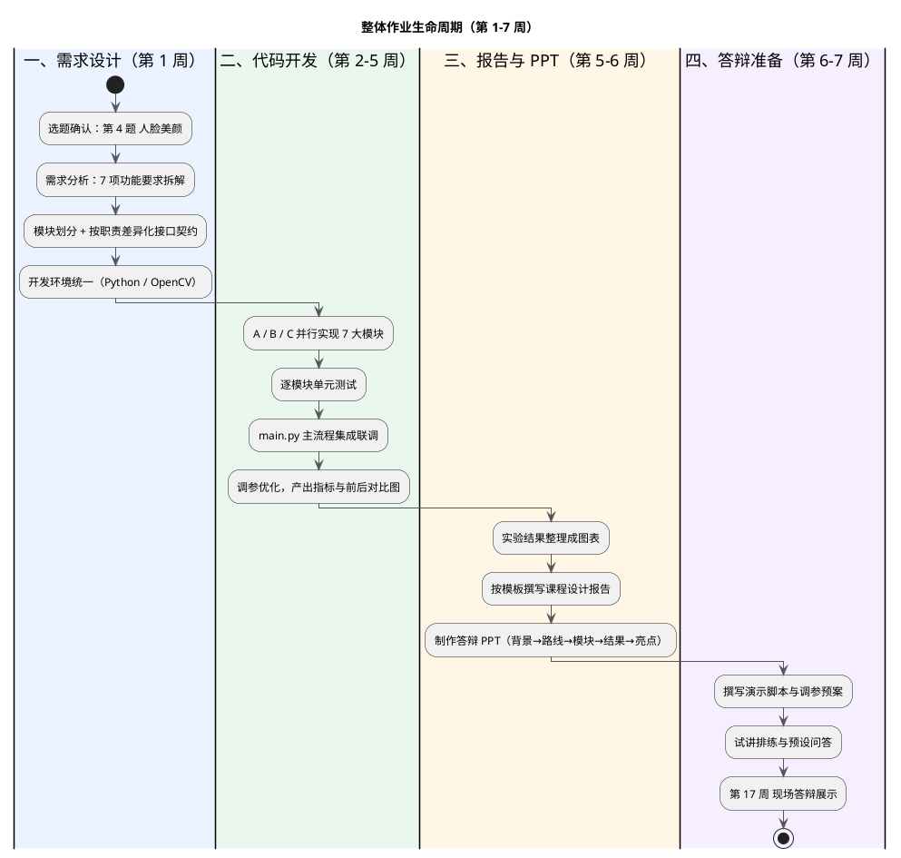

# 选题讨论报告 —— 人脸美颜相机

> 依据：课程压缩包《task-book-and-grading-criteria-dip2026.docx》
> 用途：组内讨论选题，供组员传阅

---

## 一、课程给出的选题清单（7 选 1，分组完成）

| 编号 | 选题 | 核心考点 | 客观指标 |
| --- | --- | --- | --- |
| 1 | 手机文档扫描与可读性增强系统 | 采样量化、色彩空间、空间域增强、频域去网纹、复原、二值化锐化 | PSNR、SSIM、OCR 识别率 |
| 2 | 老照片数字修复与彩色增强系统 | 去噪、频域抑噪、逆滤波/维纳复原、褪色校正、伪彩色 | 主观 + PSNR/SSIM |
| 3 | 低照度彩色监控图像增强与复原系统 | 低照度增强、同态滤波、运动模糊复原、白平衡 | 可辨识度 + 噪声水平 |
| 4 | **人脸美颜相机——肤色保护与细节增强**（本组选定） | 肤色检测、保边平滑、频域磨皮+细节、曝光改善、模糊复原、白平衡 | 主观为主 + 边缘保持指标 |
| 5 | 医学影像综合增强与伪彩色显示系统 | 空间域增强、频域去噪、复原、伪彩色映射 | 客观指标 + 可读性评价 |
| 6 | 工业产品表面缺陷检测预处理系统 | 光照校正、去噪、纹理抑制、复原、边缘增强二值化 | 检出率、误检率、PSNR |
| 7 | 自选题目 | 自定，须覆盖本学期所学 | 自定 |

统一约束：**仅限传统方法，禁用深度学习**；技术覆盖须含空间域、频率域、图像复原、彩色图像处理。

---

## 二、本组选题

第 4 题：**人脸美颜相机——肤色保护与细节增强**。

定位：在保留皮肤纹理与五官边缘的前提下，完成去痘、磨皮、提亮、锐化、白平衡，做"肤色保护型"美颜，而非暴力磨皮。

题目要求拆成 7 个处理模块：

1. 色彩空间转换与肤色检测
2. 空间域平滑皮肤、保护边缘
3. 频率域高斯低通/高通组合，磨皮 + 细节增强
4. 直方图均衡或伽马校正改善曝光
5. 轻微运动模糊复原
6. 彩色增强与白平衡，避免肤色偏色
7. 主观评价为主，辅以边缘保持指标

---

## 三、选此题的优势

1. 踩点最全。7 条要求天然覆盖色彩空间、空间域、频率域、复原、彩色处理五个章节，答辩时技术覆盖面最容易讲满。
2. 演示效果强。美颜前后对比直观，第 17 周现场答辩（占 20%）与 PPT 表现力占优。
3. 容错高。评分以主观评价为主，不依赖单一硬指标；磨皮强度、曝光、色温等参数可调，本身即可作为"程序功能"加分点。
4. 效果可验证。CelebAMask-HQ 自带皮肤/五官掩码，可直接作为肤色检测的标准答案（GT），把"肤色保护"量化成 IoU/准确率/召回率，不靠空口主观。
5. 门槛可控。不训练模型，几十张图即可出结果；Python + OpenCV，三人可并行开发。

需正视的风险：本题目技术深度偏浅，易同质化，只调一个 `bilateralFilter` 加滑块拿不到"设计合理性/程序功能"高分。破解点在于**肤色检测的鲁棒性（遮挡、偏色）+ 频域磨皮时高通细节回注的"反蜡像感"设计**，并给出量化对比。

---

## 四、分工（暂定，A 为队长）

原则：模块边界清晰、可并行开发、每人都有独立算法亮点。按「平台 / 检测增强 / 复原评价」三个垂直板块切分，板块之间只通过冻结契约通信，由主流程串联，便于逐模块单测。接口按职责差异化定义（M1 出掩码、M5 独立复原、M7 纯计算），不再强求统一签名。

| 成员 | 负责板块 | 交付物 |
| --- | --- | --- |
| A（队长） | 平台与编排：架构设计、接口契约、`core/`、`io/`、`config/pipeline.yaml`、CLI 与 Streamlit、CI，不实现算法模块 | `core/`、`io/`、`main.py`、`app.py`、配置与 CI |
| B | 检测与增强：M1、M2、M3、M4 | `skin_detect.py`、`exposure.py`、`smooth.py`、`freq_enhance.py`、频域分层图 |
| C | 复原与评价：M5、M6、M7 | `restore.py`、`color.py`、`metrics.py`、指标 CSV |

共担：报告与 PPT 分工撰写。三人各自一条长期分支（分支名为本人名称简称，A 为 `lcy`），开发完发 PR 到 `main`，由 A 统一评审合并。

里程碑：第 1 周定接口 → 第 3 周各模块单测通过 → 第 5 周全流程联调 → 第 6 周出报告与答辩。

---

## 五、评分机制

评分依据：正确性、设计合理性、认真程度、程序功能、答辩情况。官方细项**五项各 20%**：

| 评分项 | 权重 | 要求 | 本组对应打法 |
| --- | --- | --- | --- |
| 正确性 | 20% | 程序正常执行，对合法的所有数据都能正确出结果 | 批量处理、参数校验、单元测试 |
| 设计合理性 | 20% | 架构合理，算法正确应用 | 7 模块解耦、掩码驱动、配置统一、接口一致 |
| 程序功能 | 20% | 完成基本功能，复杂/完善可加分 | 参数可调、单图与批量两种模式、前后对比输出 |
| 运行及答辩 | 20% | 讲清思路与亮点，熟练演示、清晰答问、PPT 结构清晰 | 现场调参演示；PPT 按背景→路线→模块→结果→亮点 |
| 大作业报告完成 | 20% | 报告完整，含设计过程、方法、实验，图文详细分析 | 按模板撰写，含算法、问题与解决、对比图与指标 |

课程总成绩：实验 20% + 雨课堂学习与作业 20% + 课堂考勤 10% + 大作业 50%。

拿分逻辑：**五项等权，谁都不能瘸腿**。正确性是及格线（跑不通一票否决），设计合理性 + 程序功能是拉开差距的主战场，答辩 + 报告是基本盘。

---

## 六、整体作业生命周期

从选题到答辩的完整流程，对应课程第 1–7 周：

各阶段要点：

| 阶段 | 时间 | 主要任务 | 产出 | 负责人 |
| --- | --- | --- | --- | --- |
| 需求设计 | 第 1 周 | 选题确认、需求拆解、模块划分、接口与参数定义、环境统一 | 设计方案、接口约定、环境清单 | A |
| 代码开发 | 第 2–5 周 | 七模块并行实现、单元测试、主流程集成、调参与指标产出 | 可运行工程、指标 CSV、前后对比图 | A + B + C |
| 报告与 PPT | 第 5–6 周 | 图表整理、按模板撰写报告、制作答辩 PPT | 课程设计报告、答辩 PPT | A + B + C 分工 |
| 答辩准备 | 第 6–7 周 | 演示脚本、调参预案、试讲排练、预设问答 | 演示流程、问答预案 | A 统筹 |

关键里程碑：第 12 周前提交分组与选题表；第 16 周实验检查；第 17 周答辩展示。

## 七、讨论要点

1. 是否确定选第 4 题（人脸美颜），有无其他更想做的方向？
2. A/B/C 分工是否认可，各自认领哪一块？
3. 组内开发环境统一（Python 版本、OpenCV 版本）与进度时间表如何定？